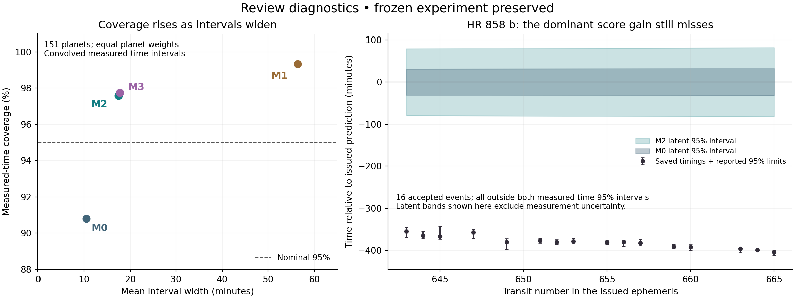

# Independent scientific and editorial review

## Judgement for Barry

**This is a scientifically worthwhile foundation, but it is not yet a strong, broadly interesting paper about transit-forecast reliability. I recommend a bounded expansion of the scientific question, alongside substantial compression and rewriting.** I would not ask you to invest several hours in the present manuscript before the next round of work.

The study's strengths are real: an explicitly frozen comparison, later observations kept separate from model development, a serious attempt to qualify the timing measurements, retention of failed recoveries, and an honest inconclusive primary result. My checks support the headline arithmetic. There is no basis here for dismissing the project as numerically unreliable, or for discarding the experiment because its primary interval crosses zero.

The principal problem is scientific reach. The study establishes how one population correction behaves on accepted measurements from one later release and observing block, under a particular conditional loss. It does not yet determine **which forecasts need attention, why they fail, or whether the correction improves an observing decision**. Its most influential system provides a concrete reason to ask those questions: HR 858 b receives a large score improvement even though none of its 16 accepted timings lies inside either method's 95% interval.

The present work could support a focused methods/data audit after essential repairs. That would be a defensible paper, with a useful negative result and reusable measurements. Given your stated preference for impact over speed, however, I recommend one integrated paper asking:

> **When do published transit ephemerides need special treatment, and can information available before the event identify those cases more effectively than widening every forecast?**

The smallest coherent expansion is a historical-information audit, independent validation of influential measurements, one simple targeting or update rule, and evaluation across a genuinely additional observing block. Add an explicitly limited observing-window comparison to connect the statistics to use. A catalogue-wide dynamical fit, a large machine-learning model, or a full telescope scheduler is unnecessary.

**Readiness:** substantial scientific revision before submission. **Main weaknesses:** unresolved identification validation at the influential cases; an incompletely justified observation-error/score interpretation; limited transfer evidence; and an article organised around the development process rather than a scientific argument. **Recommendation:** expand the question modestly and coherently; preserve the frozen experiment exactly.

---

**Review date:** 9 November 2026.  
**Repository:** [BWBrook/transit-forecast-audit](https://github.com/BWBrook/transit-forecast-audit).  
**Audited commit:** [`629f466a2567152047d9cd75be336d865a1d68ad`](https://github.com/BWBrook/transit-forecast-audit/tree/629f466a2567152047d9cd75be336d865a1d68ad).  
**Manuscript:** `manuscript/paper.md`, repository draft v0.5.  
**Review status:** independent examination of the supplied study, not an amended protocol or a new confirmatory analysis. No changes were made to the project repository or its remote. All numerical additions below are explicitly review diagnostics.

## 1. What I checked, and what the evidence establishes

I read the manuscript in full before using the claims ledger, protocol, final reports, sensitivities and code to investigate particular claims. I examined the two main held-out figures visually. The reviewed source snapshot was retrieved at the pinned commit, with downloaded file bytes checked against Git blob hashes. The statistical and measurement checks supplied with this review do not import the project's scoring or fitting modules.

The checks have different evidential strengths. Reaggregating a saved score is useful arithmetic verification, but it does not independently validate the light curve, the planet identification, or the observation model. Conversely, an independent quadrature calculation can check the numerical convolution without establishing that the convolved distribution is the right statistical object. Those distinctions apply equally to the project's reciprocal reviews.

### 1.1 Verified numerical findings

| Quantity | Result verified in this review | Evidential basis |
|---|---:|---|
| Intended primary opportunities | 3,103 | Terminal ledger; unique manifest IDs |
| Accepted timings / planets / hosts | 2,185 / 151 / 151 | Ledger-to-measurement joins; unique accepted measurement IDs |
| Grid-scored, non-Gaussian accepted timings | 399 | Saved measurement flags; their grids were not regenerated |
| Primary M2 − M0 standardised IS95 | −0.1213078045 | Independent equal-planet aggregation |
| Reported joint-refit 95% interval | [−1.839772911, +2.195684963] | Percentiles recomputed from all 2,000 stored paired draws; underlying refits not rerun |
| Nominal-95% measured-outcome coverage | M0 0.9079365; M2 0.9757620 | Independent aggregation of saved per-planet results |
| Mean 95% measured-outcome interval width | M0 10.4851 min; M2 17.4730 min | Same aggregation |
| Planets with lower M2 score | 40/151 | Independent paired differences |
| Median planet score difference | +1.04533 | Same differences |
| Fixed-parameter difference excluding HR 858 | +0.6021900 | Descriptive influence calculation only |
| Accepted events with qualifying coverage at the prediction | 2,181/2,369 | Independent ledger check; four other accepted timings correctly remain included |

The terminal counts also close exactly: 431 without cadence coverage at the prediction, 290 excluded for coverage, 75 unresolved integration cases, 71 prior-edge cases, 39 identification failures and 12 unresolved likelihood-support cases. The 431 rows actually have zero saved window coverage; there is no discovered count/label discrepancy there. [E2–E5]

I independently recomputed M0 and M2 scores for **all 1,786 accepted Gaussian events**, using closed-form normal calculations for M0 and adaptive quadrature plus root solving for M2. For the **109 planets whose accepted events are all Gaussian**, comparison with the saved complete per-planet summaries gives maximum absolute differences of approximately **2.05 × 10⁻¹¹ standardised units** and **6.33 × 10⁻¹¹ minutes**. Coverage agrees to floating-point precision. This is stronger than reaggregating the supplied scores, but it leaves the 399 non-Gaussian event convolutions unverified by this review's own implementation.

The stored primary bootstrap is numerically well behaved in the checks performed: all 2,000 paired deltas are finite. Its host sets contain 206 calibration hosts and 151 evaluation hosts, with 92 shared hosts and 265 in their union. M2's stored bootstrap spread-parameter quantiles are **s = 1.242–2.716**, around the fitted 2.047; the extrema are well inside the imposed upper bound. There is no demonstrated final-bootstrap boundary collapse. Thirty-seven downloaded files bound by the freeze manifest were hash-checked against it, with no mismatches. This was a subset check, not a complete rerun of the freeze verifier in its original environment. [E2, E6]

I also reaggregated all eleven saved sensitivity cases, including the baseline. Their point contrasts reproduce, spanning −0.7230 to +0.6403; all their saved conditional intervals include zero. Scenario refits and those interval simulations were not rerun in this check. [E5]

### 1.2 Additional review diagnostics

These are **exploratory calculations on inspected outcomes**. They do not replace the frozen primary result.

| Diagnostic | Finding | Interpretation |
|---|---|---|
| Fixed-parameter host-bootstrap coverage intervals, 10,000 draws | M0: 87.85–93.44%; M2: 95.78–98.89% | Under this conditional empirical-host analysis, baseline undercoverage and corrected overcoverage are supported; neither is a statement about true transit times or all attempted observations |
| M2 − M0, score divided by forecast-only SD | +0.0815 | The point sign differs from the primary score's −0.1213; different normalisers define different weighted losses |
| M2 − M0, raw-minute interval score | −8.4604 min | This is a score difference, not minutes of telescope time saved |
| Raw scores after descriptively omitting HR 858 | M0 13.82, M1 52.79, M2 17.46, M3 17.74 min | The raw ranking is highly dependent on this host; omission is explanatory, not a revised cohort |
| HR 858 share of baseline planet-weighted raw score | 87.1% | Absolute baseline loss is even more concentrated than the standardised contrast |
| Final accepted-event measurement SD / forecast SD | Median 2.694; interquartile range 1.715–3.734 | Measurement uncertainty is a large component of the scored target; for non-Gaussian cases these are the reported sigma summaries, not the exact grid variances |

For HR 858 b, I verified 16 accepted timings 5.92–6.73 hours early, with forecast SDs of 15.90–16.44 minutes. Every method has **zero** 95% coverage for these events. Mean measured-time interval widths are 65.97 minutes for M0 and 162.04 minutes for M2; even M1's 593.04-minute mean width covers none. The M2 planet-mean score gain is −108.646 standardised units. [E3–E5]

The right panel deliberately excludes measurement error from the forecast bands. It is an illustration of the latent forecasts, not a full scheduling analysis. The separate zero-coverage statements above come from the project's convolved measured-time interval summaries.

### 1.3 What remains unverified

I did **not** independently extract TESS photometry, identify transit trains in pixels or light curves, regenerate the likelihood grids, rerun all 2,000 calibration refits, or establish every exposure-level lineage. I did not rerun the reported full 115-test suite. The portable repository does not contain the non-Gaussian grids or the event-level final score table; those are described as regenerable/off-repository products. The existing audit's bounded grid and refit checks are documented evidence, not calculations repeated here. The repository records support the chronology and disclosed execution correction; they are not an immutable record proving everything an investigator had or had not seen. [E6–E8]

No failure to access an artefact is being treated as evidence that the data do not exist. These limits determine which claims this review can independently support.

## 2. Scientific substance, novelty and likely interest

### 2.1 The question matters, but three questions are being compressed into one

There are three distinct targets:

1. **Catalogue adequacy:** how well do a published linear ephemeris and its stated parameter uncertainties describe later timing measurements?
2. **Statistical improvement:** does this learned population correction improve a specified loss on those measurements?
3. **Decision value:** does a different forecast or warning policy help an observer obtain the required transit data for an acceptable expenditure of time?

The current experiment primarily answers the second, conditionally, and provides useful evidence for the first. It motivates the third without measuring it. That distinction should organise the paper rather than be left to the limitations.

The strongest current contribution is **a traceable, temporally separated test showing that a promising population correction did not establish average improvement on the chosen loss**, together with the observed coverage–width tradeoff and its concentration across systems. That is informative. It prevents a development result from being promoted to an established forecasting tool.

The inconclusive result also reflects limited information about rare failure classes, one release transition, a narrow accepted-measurement population and a loss whose relation to telescope use is indirect. The 2,185 timings give useful within-system information; they do not supply 2,185 independent examples of whether a catalogue contains a problematic system. More transits of HR 858 would refine its trajectory without resolving how frequently comparable hosts occur.

### 2.2 The novelty is primarily an audit/benchmark contribution

The study does not introduce retrospective ephemeris validation, covariance propagation, heavy-tailed timing likelihoods or proper scoring. ExoClock IV already evaluates earlier catalogues against later TESS measurements and explicitly distinguishes its optimistic, partly in-sample DRD comparison. That is the direct benchmark, not a distant contextual citation. [R1]

Two additions to the literature discussion would sharpen the positioning. **Agol et al. (2024)** empirically calibrate TRAPPIST-1 forecast uncertainty using leave-one-out predictions of 23 JWST timings, then publish updated forecasts. This is a close precedent for calibration of *forecast* uncertainty, although it is a single dynamical system rather than population transfer between releases. **Lissauer et al. (2024)** provide a substantial published treatment of why precisely measured average periods need not imply accurate future ephemerides; use this alongside or instead of the current 2020 conference abstract. [R2, R3]

ExoEcho I is relevant to influential timing measurements and uncertainty treatment, but its fit diagnostics should not be equated with an untouched future forecast test. The manuscript's bounded citation search is useful provenance; “we did not find these five features together in 82 forward citations” is not an effective scientific contribution statement. The targeted search in this review does not prove the absence of a precedent either. [R4]

The likely interest is therefore:

| Audience | Present value | What would let them act differently |
|---|---|---|
| Ephemeris catalogue maintainers | External audit, failure examples, reproducible comparison | A dated assessment of warning flags, information age and which failures are detectable before issue |
| Observers and mission planners | Evidence that nominal intervals warrant scrutiny | Capture/padding tradeoffs, clear warning or refresh criteria, and the cost of exceptions |
| Exoplanet dynamics researchers | Interesting systems and a later timing sequence | Independently validated new timings and a justified comparison with physical forecasts |
| Astrostatisticians and forecasting researchers | A realistic case involving noisy outcomes, clustered data and distribution shift | A compact reusable benchmark, explicit estimands, and tests of the observation-model assumptions |
| General astrophysicists, planetary scientists and quantitative outsiders | A transferable lesson about predictive reliability | A short scientific narrative that explains what was learned, which explanation remains plausible and what decision follows |

A focused paper is defensible, but it should be sold as a conditional forecast audit and benchmark. A broader paper needs evidence that discriminates between explanations or changes practice. Adding technical machinery alone would not supply that evidence.

## 3. Material scientific and methodological findings

### R01 — Define the scoring target before interpreting it

**Anchors:** manuscript §§1, 2.2–2.3, Table 2 and limitation 6; `scripts/sprint1_outcome_adapter.py` (`score_outcomes`, `grid_score`); `scripts/sprint1_forecast_core.py` (`predictive_scores`).

For a planet p with accepted events i, the realised primary statistic has the form

\[
\widehat\Delta=\frac{1}{N_P}\sum_p\frac{1}{n_p}\sum_{i\in A_p}
\frac{\operatorname{IS}_{.05}(F_{2,pi}*\widehat Q_{pi},y_{pi})-
\operatorname{IS}_{.05}(F_{0,pi}*\widehat Q_{pi},y_{pi})}{d_{0,pi}}.
\]

Here F is the latent timing forecast, Q is an observation-error representation obtained from the photometry, A is the accepted set, and d is the baseline predictive SD including observation error. The denominator uses the grid variance in the non-Gaussian branch. This is an evaluation of **measured timings under a specified measurement and acceptance procedure**, not simply the issued latent timing distribution.

Using the same positive divisor for all methods avoids a model choosing its own favourable scale. It does not by itself establish unconditional propriety. However, the converse claim—“the error bar was measured afterwards, so the score is necessarily improper”—would also be wrong. If an observation-error descriptor is ancillary for the latent timing conditional on origin information, and its conditional measurement model is correct, a proper conditional score remains proper after averaging over that descriptor with positive common weights. That is a conditional-expectation argument; the issue is whether its assumptions hold here. It addresses weighting only. Conditioning on recovery additionally requires ignorable selection for the target or a predictive model that explicitly accounts for that selection. The fitted errors, grid shapes and acceptance are all derived from the same photometry and can depend on phase, gaps and misfit. [R5–R7]

**Conclusion threatened:** an unconditional claim of issue-time forecasting skill, or a claim that the primary score directly ranks observing policies. The frozen numerical comparison remains a valid description of the declared loss.

**Essential repair:** state the target, conditioning and measurement assumptions explicitly. Call the baseline “issued ephemerides evaluated under the reconstructed covariance and observation model”; do not repeatedly describe the convolved intervals as if ExoClock had published them. Keep the frozen primary endpoint unchanged.

**Useful check:** a small end-to-end simulation using the existing injection machinery should compare known latent errors with the measured/accepted score under phase-dependent gaps, shared shape error and error estimates correlated with misfit. Include departures from the fitted M2 family. This would test the interpretation rather than merely show that the code recovers its own model.

The 95% interval score identifies two quantiles, not the entire predictive distribution. The additional log score and coverage levels are useful diagnostics, but the primary endpoint alone cannot establish that the whole predictive density is well calibrated. [R5]

### R02 — Explain the different rankings as different loss functions

**Anchors:** Table 2, §3.4, Discussion's release-transfer paragraph; `results/final_secondaries/descriptive/planet_metrics.csv`.

M1 is worst on the primary standardised score and best on the raw-minute point score. M2 − M0 is −0.121 on the primary scale, +0.0815 when divided by forecast-only SD, and −8.46 minutes on the raw scale. These are not contradictory computations. Raw scores attach loss to physical timing units; the normalised scores give more relative weight to errors in nominally precise forecasts. Their different rankings expose a substantive choice about which failures matter.

The score's units also need careful interpretation. An IS95 of 106 minutes is a width-plus-miss-penalty, not an observation duration or a mean timing error. The coefficient on a miss is 40. An 8.46-minute score reduction does not mean 8.46 minutes of telescope time were saved.

For fixed symmetric widening, with added width Δw, the interval-score change lies between −19Δw and +Δw. Beyond both interval endpoints the gain saturates. The manuscript has correctly repaired the earlier unbounded-contrast explanation. This is also why a severe miss can earn an improvement while remaining a miss. [E1, E3, E7]

**Conclusion threatened:** declaring a method globally best/worst, or describing rare losses as avoided merely because its score falls.

**Essential repair:** show the three principal loss scales side by side, with paired uncertainty and clear inferential labels. Explain the physical meaning of each before interpreting rankings. Do not choose a new primary score because it now gives a preferred sign. Use a separate observing loss for practical conclusions.

The fact that 111 planets score worse is a distributional result, not a refutation of M2. Small frequent costs can rationally buy protection against rare severe losses. What is unresolved is whether the relevant protection has been achieved at an acceptable cost and whether its frequency transfers to other systems.

### R03 — HR 858 b needs independent identification and timing validation

**Anchors:** §3.2, §4.7, Discussion; `scripts/check_hr858b.py`; `docs/audits/d068_hr858_source_review_2026-11-09.md`; saved measurement/product tables.

The saved sequence is coherent: an independently centred fit gives a local period of 3.58394977 days and scatter of 4.26 minutes about a line. The reported shape diagnostics and leave-one-out timing shifts do not explain a six-hour offset. These observations support a real departure; they do not independently establish target identity or the correctness of the extraction.

This matters because a documented false identification, WASP-54 b in development, materially changed a calibration fit. The later gross-fit gate removes the known failure but does not measure the false-identification rate of the final pipeline. Validating the arithmetic of HR 858's table several times does not resolve that concern. [E1, E4, E7]

The cohort definition has a physical consequence: “one DRD-catalogued planet per host” is not “one known planet”. All 2,185 accepted primary rows have no other DRD planet masked, including HR 858. Independent checking must account for known companions, including possible overlapping events, rather than inheriting catalogue incompleteness.

**Conclusion threatened:** the reality and interpretation of the major forecast departure, the concentration of gains, and potentially the fitted correction if similarly influential training inputs are defective.

**Essential validation:** independently extract or detrend the relevant light curves, identify the transit train without using the issued epoch to force the answer, verify cycle assignment and BJD_TDB handling, and model or mask all known companions. Compare depth, duration and shape across sectors; use pixel/centroid information if ambiguity warrants it. Marginalise or vary the important nuisance parameters. Include other major evaluation contributors (TOI-905 b, WASP-184 b and TOI-559 b), influential calibration systems, and a small representative control sample. A genuinely different implementation and an experienced transit analyst's inspection would be more valuable than another reciprocal table audit.

Retain HR 858 in the frozen result. If an error is found, publish the original result plus a labelled corrected analysis and explain which conclusions change. Do not silently repair the historical experiment or exclude the host because it is influential.

### R04 — Historical knowledge is a competing explanation, not a nuisance flag

**Anchors:** §2.1 “Origin-known flags”, §3.2 TTV diagnostic, Discussion's targeted-forecast hypothesis.

The actual rule is absence of a TTV flag in the issued ExoClock release. That flag is not an exhaustive record of what astronomy knew at issue. Bonfanti et al. had published a specific warning of hours-scale departures for HR 858 b before DRD. Their illustrated integration starts in 2018; it is **not** a directly issued prediction of this study's 2026 residual. [R8]

**Conclusion threatened:** interpreting the influential departure as an unrecognisable population tail, or interpreting “unflagged” as a physical negative.

**Essential repair:** use the exact catalogue-based definition throughout. Keep current NASA flags as dated descriptive labels, not historical predictors. Distinguish a formal linear-fit parameter error from total forecasting error caused by model inadequacy, old information or missing warnings. A forecast can fail practically without its conditional standard-error calculation being arithmetically wrong.

**Substantive extension:** construct an issue-dated information ledger for the entire cohort, recording source-defined TTV flags, pre-origin literature warnings, known companions, data age and uncertainty about missing information. Develop a simple warning or update policy from that information. Unknown or unsearched status must not become “no TTV”. Do not build the rule only around the named systems that currently look bad.

A quantitative dynamical comparison for HR 858 would require the original joint parameter samples, or another defensibly reconstructed pre-origin predictive distribution. Marginal parameter intervals alone are insufficient to recreate that covariance. A case-specific dynamical comparison is optional; the proposed study does not require a catalogue-wide N-body model.

### R05 — Accepted-timing reliability is not recovery or observing risk

**Anchors:** §§2.4, 3.3, 4.5; Table 1; `scripts/acceptance.py` (`terminal_status`); `scripts/final_evaluation.py` (`terminal_ledger`).

The attempt ledger is a substantial strength. It still does not identify how many true transits lay outside the predicted window, or how many a proposed observation would miss. Some failures have no usable photons; others have photons but an unresolved timing or identification. They require different treatment.

The manuscript describes the ±0.5% period search and the timing support limits. It should also disclose the code's **P/4 cycle-consistency gate**: an otherwise accepted timing is rejected when its displacement from the issued prediction exceeds one quarter of the period, after nearest-cycle mapping. There are no primary terminal rows in that class, but the rule still restricts which departures the procedure can identify and score. A large coherent epoch offset is not equivalent to a large irregular per-transit displacement; the pipeline can recover the former while losing the latter. [E1, E4]

**Conclusion threatened:** extrapolating 90.8% or 97.6% coverage to all transits, or interpreting 92.1% prediction-qualified recovery as a telescope success probability.

**Essential repair:** display the whole population-to-outcome flow and state the error-related identification restrictions in the main methods. Keep the four accepted events with unqualified prediction-time coverage; they demonstrate why prediction-time and actual-event coverage differ. Report the five zero-accepted-timing planets, not just the total event recovery.

**Useful bounded extension:** independently investigate those five planets and a structured subset of failed events in products with broad coverage. Search over a wider, explicitly justified domain and account for known companions. Classify absent photons, inadequate signal, ambiguity and failures of the current extraction separately. Non-detection is not a precise timing, and every failure is not an ephemeris miss.

For population-wide capture, report sensitivity/partial-identification bounds where event truth remains unresolved. Construct bounds at the declared weighting level. Multiplying 70.4% event recovery by planet-balanced interval coverage mixes denominators and is invalid. Inverse-probability weighting cannot recover regions with structurally zero recovery without additional assumptions and information.

### R06 — The observation distributions need more accurate terminology and bounded validation

**Anchors:** §2.4 timing description; §§2.2–2.3 convolution; `scripts/t015_timing_pipeline.py` (`time_transit`); `scripts/sprint1_outcome_adapter.py` (`likelihood_grid`, `grid_quantiles`).

At each trial mid-time the timing code profiles linear baseline coefficients, fixes a planet-sector transit shape, and normalises exp(−profile χ²/2), with a noise scale estimated from the data. A flat prior on mid-time does not make this a fully marginal posterior over the other unknowns. Call it a **conditional profile-likelihood timing distribution**, or explicitly justify the approximate-posterior interpretation.

A second distinction matters for non-Gaussian cases: a likelihood over true time, given a light curve, is not automatically the repeated-measurement sampling distribution of the reported timing estimator. Reflecting its offsets to form an error kernel is justified under a location-family/ancillary approximation, not solely by a flat prior. The code's reflection sign is internally consistent; I found no sign defect. The question concerns statistical interpretation, not numerical convolution accuracy.

The injection experiments are useful evidence of conditional measurement calibration. They do not exhaust shape mismatch, stellar/instrumental structure, gaps and false identification, particularly for the cases deciding the scientific interpretation. The final sample's reported measurement/forecast sigma ratio has median 2.69. Combined predictive coverage therefore cannot uniquely attribute miscalibration to ephemeris uncertainty. [E1, E4; R7]

**Conclusion threatened:** unqualified “exact predictive distribution” or “posterior” language and attribution of all excess scatter to forecast error.

**Essential repair:** state what is fixed, profiled and estimated, and distinguish exact numerical integration from an approximate measurement model. Make that distinction visible before the results.

**Targeted validation:** compare representative high-influence and non-Gaussian cases with joint nuisance-parameter timing fits. Existing leave-one-out shape diagnostics are reassuring in the bulk—median absolute shift 0.018 sigma across 2,163 available cases—but 13 exceed 0.5 sigma and three exceed one sigma. They are a sensitivity check, not a marginalisation of shared uncertainty. Use the results to decide whether a broader remeasurement is necessary; do not rewrite the entire timing framework pre-emptively.

### R07 — Host resampling does not repair an incorrect measurement covariance

**Anchors:** §2.3, limitation 5; `scripts/sprint1_forecast_core.py` (`visit_planets`); `scripts/forecast_variance_components.py`.

The calibration fit compresses events into capped 20-day visit means, using inverse-variance weights and standard error

\[
\operatorname{SE}(\bar y)=\left(\sum_i\sigma_i^{-2}\right)^{-1/2}.
\]

The subsequent likelihood has diagonal measurement variances for those visit means, with a separate rank-two ephemeris covariance. Shared shape uncertainty is not propagated into that measurement covariance. Positive within-visit correlation can make the visit SE too small and change the fitted population dispersion.

Whole-host resampling is the appropriate improvement over independent-transit resampling. It preserves empirical dependence in the host contributions and propagates calibration-fit variability. It cannot remove bias from a misspecified within-host likelihood. A near-zero ICC in one injection setting does not establish that all relevant measurement correlations are absent. [E1, E4]

**Conclusion threatened:** the assertion that host clustering fully handles shared shape dependence, and potentially the interpretation or stability of the fitted s.

**Essential repair:** describe the diagonal-visit approximation explicitly and restrict the claim about what the bootstrap addresses.

**Useful check:** carry common shape/nuisance draws through a small set of sector transit trains, or derive a common visit-error term from those fits, then assess its effect on development calibration and held-out scoring. Label the result exploratory and leave the frozen fit intact. The approximation is demonstrated; a material resulting bias has not been demonstrated.

The calibration sums one joint likelihood per planet rather than treating every transit as an independent ephemeris error. That is a strength. Likelihood training and equal-planet IS95 evaluation nevertheless optimise different criteria under misspecification. The poor M1 standardised result cannot establish that all one-factor or population calibration schemes are ineffective. If the expanded study needs an additional simple statistical benchmark, a scalar correction learned for its explicitly chosen interval loss is more informative than several new flexible tail families.

### R08 — Transfer and uncertainty are narrower than the sample size suggests

**Anchors:** §§2.3, 2.6, 3.1 and 5.1; stored joint draws; Table 4 development results.

One release-to-release correction, evaluated in one later block, tests one transfer. It does not establish release invariance or a universal tail rate. All accepted primary events lie within the first operational lead-time year. The bootstrap resamples the empirical host distribution; it does not resample catalogue construction practices, future observing seasons or unseen classes of failure.

The wide primary interval is informative insofar as it prevents a success claim. It is too wide to establish equivalence or a practically small effect. Calling effects “substantial” on the standardised scale needs an interpretation or a prespecified meaningful-effect threshold; crossing zero alone is not the whole scientific story. The direction of point changes across sensitivities is secondary to the breadth and scope of their uncertainty.

**Essential repair:** report uncertainty in s as well as uncertainty in the average score. Explain that the tested forecasts use plug-in parameters; bootstrap refitting quantifies performance uncertainty and does not retroactively integrate parameter uncertainty into each frozen predictive interval. Describe the host population to which the interval is intended to generalise.

Also correct limitation 7's potential implication: the reported 0.853–0.927 coverage of nominal 90% intervals comes from injection-calibration estimators. It is not a measured coverage property of the final nominal-95% joint-refit score interval. [E1, E2]

**Useful next evidence:** an additional block that changes information age, observing conditions or host composition, with genuinely new outcomes for any confirmatory claim. Repeated future observations of the same systems test persistence/aging; new systems test generalisation to different hosts. Report those contributions separately. Increasing the bootstrap draw count cannot substitute for either.

### R09 — Reconstructed covariance is acceptable as an approximation; information age is underused

**Anchors:** §2.2 covariance tiers, Table 3; `docs/evaluation_protocol.md` timing definitions.

C2 is not an issued covariance. A refitted period agreeing within three reported sigma does not establish agreement in the joint epoch-period posterior, weighting or fitting procedure. The paper acknowledges this correctly. The near-identical zero-correlation and C2 scores make a gross missing-cross-term explanation less likely here; the ±1 cases provide deliberately broad stress tests, not recovered uncertainty about rho. There is no current evidence that covariance reconstruction is the dominant limitation.

**Essential repair:** keep that honest labelling and avoid allowing covariance machinery to dominate the contribution claim. If actual covariance or posterior samples become available, use them as a clearly versioned comparison.

More scientifically useful is the protocol's distinction between **operational lead time** (since publication/availability) and **extrapolation age** (since the last input observation). Add their distributions, the historical timing baseline and age/baseline ratio to the cohort description. A newly published catalogue need not contain recent observations. This can distinguish an aging-data explanation from a generic release effect and supplies a physically interpretable predictor for the proposed expansion. Preserve unknown or uncertain dates rather than inferring them from the numerical reference epoch. [E1, E8]

### R10 — Preserve inferential history, but stop making it the main article

**Anchors:** Abstract; §§2.4–2.6, 4, 6–7; protocol, claims and decision records.

The primary freeze and later secondaries are usefully distinguished. The documented full-manifest rerun after the relative-path fault is a reasonable execution repair: keeping the first attempt would select against non-Gaussian timings. The earlier audit records preservation of completed outputs. Nothing in this review warrants relabelling that as a new tuned primary analysis. Its provenance should remain accessible without occupying the scientific foreground. [E6, E7]

Likewise, the secondary names were declared before unblinding but executable conventions were completed afterwards. They are useful supporting analyses, not fully prespecified confirmatory tests. Their scenario-fit conditional intervals cannot replace the joint-refit primary interval. The ten sensitivity point estimates changing sign while their intervals include zero establish neither robust equivalence nor a reliable correction.

**Essential repair:** provide one unambiguous current entry point to the final frozen specification. `docs/evaluation_protocol.md` retains historical/provisional language and the README retains dated earlier milestones. Preserve those records, but identify the authoritative final manifest/configuration and the change history clearly.

For a reusable benchmark, archive the small derived artefacts needed for direct scoring: event-level forecasts, outcome tables, likelihood grids, final score table, terminal ledger and a data dictionary. The approximately 50 MB of grids are manageable as a versioned release/deposit. Checksums make missing files verifiable after acquisition; they do not make them available. Raw TESS files can remain at MAST with product IDs and hashes. The current public snapshot is an excellent audit trail but an incomplete lightweight evaluation package. [E2, E7, E8]

## 4. The smallest coherent expansion I recommend

### 4.1 A larger question with competing explanations

Ask whether failures are sufficiently identifiable from pre-event information to warrant **targeted warnings or updates**, rather than a universal increase in uncertainty. The present result suggests at least four explanations that imply different actions:

| Explanation | Discriminating evidence | Consequence if supported |
|---|---|---|
| Ordinary parameter uncertainty is broadly too small | Reliable measurements, no strong historical-risk concentration, stable calibration across blocks | A simple population correction may be useful |
| Some systems have recognisable departures from linear timing | Dated literature/architecture information predicts later failures beyond basic uncertainty and age | Warning or specialist forecast for a limited set |
| The information is stale | Extrapolation age and historical instability explain errors; an eligible refresh improves later performance | Prioritise new timing measurements or updated linear fits |
| Apparent tails contain measurement/identification defects | Independent extraction changes influential timing sequences or calibration inputs | Strengthen outcome validation before interpreting a population tail |

These are hypotheses, not diagnoses established by the current dataset. The purpose of the expansion is to distinguish them.

### 4.2 A concrete, bounded programme

**A. Validate decisive outcomes before designing the new rule.** Complete R03 and the focused measurement checks. Rank influence in both calibration and evaluation, and include ordinary controls. Agree in advance what discrepancies require remeasurement of a wider subset. Keep corrected or alternative measurements beside the frozen outputs.

**B. Assemble a small historical-information table.** For every eligible planet and origin, record the release flag, dated external TTV evidence, known multiplicity, last input timing, timing baseline, forecast-only uncertainty and, if supportable, a simple past-instability measure. Define the search and alias policy uniformly across the cohort. Source dates and “unknown” states are part of the data, not clerical details. Avoid a feature collection assembled only to explain the four current winners.

**C. Use the inspected data for development.** Compare the issued baseline, the frozen M2 algorithm, and one deliberately simple historically informed rule. If a statistical-only comparator is needed, choose one scalar padding/calibration rule aligned with the stated loss. Do not start a contest among many heavy-tail distributions. A warning policy must report the fraction referred/abstained and the burden of that action; evaluating only the targets it retains gives free credit for declining difficult cases.

**D. Add a limited decision analysis.** Start with an idealised, continuously observable transit, not a facility-specific scheduler. Let a latent timing interval be [l,u], a predicted duration D, and required pre/post baselines b_pre and b_post. A candidate observing window is

\[
W=[l-D/2-b_{\rm pre},\ u+D/2+b_{\rm post}].
\]

Compare the allocated duration with whether the required actual transit-plus-baseline interval is contained in W. Show a capture-versus-time curve or a small family of losses such as allocated minutes plus a stated penalty for a failed capture. Propagate relevant duration/timing uncertainty. **Do not add the later TESS measurement error to the schedule's padding.** It belongs to verification. Where a measured time is too uncertain to determine containment, integrate over a justified observation model or report bounds. Initially this remains conditional on identifiable events; R05 explains what is needed to extend it.

A refresh policy needs a real, historically eligible refresh forecast. It cannot be credited with an oracle timing, and its acquisition cost is not zero. If no such comparator is available, evaluate warning sensitivity versus the fraction flagged and call it triage, rather than claiming time savings.

**E. Replicate meaningfully.** Use existing historical releases and additional observing blocks to separate release, population and information-age effects. Show common-planet/event comparisons where possible, alongside each release's natural cohort. Cluster repeated contributions by host across releases. A few release transitions cannot support an elaborate population-of-releases model.

**F. Reserve a new evaluation before opening it.** The 2024-to-pre-DRD gap is a candidate because the documented development cutoff is early 2024, but its untouched status, lineage and usable host count have not been verified here. Treat it as historical replication by default. Any confirmatory use must also justify information flow and temporal dependence: unopened earlier photometry is not automatically independent when the same hosts' 2026 behaviour informed the new rule, particularly with shared ephemeris errors or TTV state. Prediction origins and training data must respect time ordering, and a rule developed after seeing 2026 results is not a historically issued 2024 rule. A genuinely later TESS block is preferable for prospective transfer, but can require waiting. Freeze metadata-based eligibility, the outcome-measurement rule, the loss and the decision rule before inspecting the new outcomes, with no optional stopping after a favourable result.

**G. Publish a compact benchmark with the paper.** Include the frozen experiment and the new developmental/confirmatory versions under distinct identifiers. Offer one command that starts from the archived derived data and recreates the central tables, and separate commands for expensive raw-photometry reconstruction. This directly increases reuse without inflating the manuscript.

### 4.3 Data availability and feasibility

| Requirement | Availability established in this review | Remaining work |
|---|---|---|
| DRB/DRC/DRD issued products and current outcome manifests | Versioned products, acquisition code and hashes documented in the repository | Reacquire required raw release files; audit dates for each new use |
| TESS light curves and pixel products | Official MAST access and product types verified [R9] | Verify exact additional sectors, targets, processing versions and whether outcomes remain uninspected |
| Alternative timing/ephemeris product | Ivshina–Winn author database exposes downloadable tables [R10] | Establish historical version, public availability and exposure overlap before using it as a comparator |
| Origin-dated risk information | Concrete pre-origin studies exist; catalogue flags are available | Cohort-wide dated curation and a uniform definition; current archive flags alone are insufficient |
| Physical predictive samples for HR 858 | Published dynamical analysis exists [R8] | Original joint samples and a valid propagation to the new epoch are unverified |
| Event-level non-Gaussian evaluation data | Hashes and regeneration routes exist | Public versioned deposit; raw-photometry validation remains necessary for identity |
| A fresh confirmatory block | Plausible from continuing/unused TESS coverage | Not established here; requires metadata/access-history audit and adequate independent systems |

The likely bottlenecks are historical curation and independent photometric checking, not another optimiser. As a planning estimate, this is several focused person-weeks of scientific work, with potentially longer calendar time if a genuinely new observing block is required. This is not a promise about agent runtime or data availability. A small specialist collaboration would be valuable; the next task is to prepare evidence for that review, not merely request a general endorsement.

### 4.4 What would materially change the conclusion?

- **Historically informed triage works:** a limited set of issue-time indicators catches a useful fraction of subsequent failures while referring relatively few targets. The paper then contributes an actionable warning/update strategy.
- **Uniform widening works across blocks:** improved capture or an agreed loss at an acceptable cost would support a simple correction, even if most individual planets have small score losses.
- **Neither works:** effects vary across releases or failures remain difficult to anticipate. That would establish limits on simple extrapolation/calibration and a case for monitoring, provided the precision and population are sufficient.
- **Independent extraction changes the influential cases:** the paper's contribution becomes partly about outcome validation and the danger of treating a timing catalogue as error-free truth. The original frozen result remains part of that account.

None requires a statistically significant M2 victory. A result that discriminates among these explanations is more valuable than a slightly narrower interval around the current average.

### 4.5 Two serious alternatives

| Option | Larger question and necessary analysis | Feasibility, conclusion-changing result, and placement |
|---|---|---|
| **Release/age benchmark as the main paper** | How does reliability vary across issued releases, age of information and independent observing blocks? Use verified release products, common-planet comparisons, identical outcome rules, recovery accounting and host dependence. | Existing releases make this feasible, but new outcome coverage and historical availability require checks. Replicated calibration or strong release dependence would be useful even without a winning correction. A limited version belongs in this paper; a broad cross-mission/cross-catalogue service can be a distinct later study. |
| **Recovery-aware observing risk as the main paper** | How much observing time buys a specified probability of full-transit capture, including difficult or unrecovered events? Requires independent wider searches, cadence/duration models and bounds where truth is unresolved. | Scientifically compelling but substantially larger. The ledger alone is insufficient. A large gap between successful-timing coverage and actual capture risk would change practice. Include only a modest conditional replay now; a validated population-wide scheduling/allocation model is a genuinely different subsequent project. |

My preferred route combines a small historical-triage comparison with enough release/age replication to test whether its lesson travels. It does not require completing either alternative at full scale.

**Extensions that would mainly add volume:** more mixture families on the same inspected cases; more bootstrap draws without a concrete numerical problem; many new bins containing few independent systems; thousands of extra timings at essentially the same horizon on the same hosts; another narrative of internal reviews; or a separate HR 858 paper that adds no physical inference beyond its role in this audit.

## 5. Editorial review and a stronger article

### 5.1 The manuscript reads too much like a development record

The opening sentence identifies a useful problem. It then quickly becomes a literature list, a five-component novelty claim, and a history of which internal rule was selected when. The abstract's file/grid counts and the main text's repeated identifiers ask readers to learn the repository before they can understand the science.

The detailed history is valuable and should be preserved. Its place is primarily a supplement or agent guide. A reader should not have to reconstruct `t015v3`, `t015v3c`, `t015v3a`, sprint 1, sprint 2, R5 and several candidate parameter sets to know which outcomes and calibration produced Table 2.

The prose is more careful than inflated, but it is repetitive and often defensive. “Inconclusive”, “not a new decision”, “conditional”, “independently reviewed” and “not a second full run” recur so frequently that they obscure the finding. State the inferential status once in a compact evidence-status table, then repeat a qualification only where it changes the interpretation. A caveat should identify an unresolved scientific issue, not merely certify that the authors know one exists.

The introduction should distinguish formal parameter precision, future timing error and observing success in familiar language. Define an ephemeris as a rule for predicting event times, explain why a tiny period error accumulates, and explain that planetary interactions can violate constant-period extrapolation. Introduce M0/M2 only after the reader knows what is being compared. Avoid “honest” as a substitute for a defined calibration property.

### 5.2 Suggested main article structure

1. **Introduction:** observing consequence; parameter precision versus predictive reliability; closest existing tests; the unresolved transfer question and this study's contribution.
2. **Forecasts, outcomes and design:** a dated schematic/table of training and evaluation; the exact cohort; brief measurement qualification; the conditional scoring target and host dependence. One table gives descriptive names for M0–M3.
3. **Frozen evaluation:** cohort/recovery accounting, primary contrast, coverage/width, and different loss scales. Lead with effect sizes and uncertainty, not the pass/fail label.
4. **What drives the failures:** influential systems, independent measurement checks, information age and historical warnings. If expanded, test the simple triage/update comparison with its inferential status explicit.
5. **Implications:** what users can infer, where the findings generalise, what remains unidentified and whether an observing policy is supported.
6. **Availability and contributions:** concise, with permanent links to benchmark, protocol and audit trail.

As a working editorial target, a main text around 5,000–7,000 words plus a substantive supplement would be easier to assess than the present extensive development narrative. The appropriate final length depends on the added science; this is not a demand to cut evidence arbitrarily.

| Keep in the main article | Move to supplement | Keep primarily in repository/agent guide |
|---|---|---|
| Frozen temporal split; accepted/intended population; key measurement assumptions; principal results; influence and selection; scientific alternatives | Full injection criteria and confirmation history; detailed covariance reconstruction; sensitivity table; measurement stress tests; complete model equations and fitting diagnostics | Commit-by-commit decisions; access authorisation text; path-fault chronology; exact commands/environment hashes; retired candidates; per-agent task chronology |

The full AI contribution history can remain public, while a short journal-appropriate disclosure says what systems did and what the human author is responsible for. It should not compete with the scientific result for space. Reciprocal agreement remains process history, not a validation endpoint.

### 5.3 Figures and tables

**Current Figure 1:** useful evidence of concentration, but the symmetric-log display makes visual bar areas unsuitable for judging contribution to the arithmetic mean. Explain that explicitly. Retain the named influential systems, but a current NASA flag should not be the dominant visual cue for a historical-information argument. Once a dated ledger exists, distinguish historical evidence from current labels. Put the full per-planet values in a table.

**Current Figure 2:** the primary interval is clear. The leave-gain-hosts-out curve can be mistaken for a recipe for cleaning the sample. Its title/caption should say that deletion is ordered using observed gains, fixed-parameter and purely diagnostic. It should not be the main practical figure.

**Missing central figure:** an observed-minus-predicted timing plot for HR 858 b, showing the issued and corrected bands, actual timing uncertainties and the temporal trend. The review figure demonstrates why this is scientifically more informative than only naming the host under a bar. Add comparisons for the other influential cases if they reveal distinct mechanisms.

**Calibration presentation:** show coverage against nominal level, or a carefully weighted PIT/calibration diagnostic, with host-based uncertainty and the measurement conditioning visible. Two coverage percentages do not diagnose the complete distribution. An operational extension should add capture versus allocated minutes, clearly separated from statistical interval width.

**Tables:** make Table 2 the main comparison table and include a short column explaining each method. Condense Table 3 to a few scientifically distinct checks in the main text; keep its full version in the supplement. Current Tables 4–6 mostly document development and should not occupy the same evidential tier as the frozen evaluation. Add a small cohort table with forecast SD, measured timing precision, period, brightness, release lead time and information age.

### 5.4 Alternative titles

For a focused version supported by the current experiment:

- **Testing ExoClock transit forecasts against later TESS observations**
- **Transit-forecast uncertainty in an independent TESS timing sample**
- **Coverage, precision and rare failures in published transit ephemerides**

For the preferred expanded paper, only after the additional work:

- **When do transit ephemerides need an update? A forecast audit with TESS**
- **Can we identify unreliable transit forecasts before the event?**
- **Reliable transit windows: testing uncertainty calibration and targeted updates**

The present title is understandable but very broad. The subtitle is overloaded with methodological qualifiers. A shorter title and a clear first paragraph would do more work.

### 5.5 Revised abstract for the current evidence

This draft does **not** assume that the proposed expansion has succeeded. The HR 858 coverage sentence is a review-verified descriptive addition and should be linked to the corresponding archived result if adopted.

> Accurate transit forecasts are needed to place limited observing time around planetary transits, but formal ephemeris uncertainties need not capture all future timing errors. We tested ExoClock's DRD linear ephemerides against later TESS observations and evaluated a population uncertainty correction learned from DRC forecast errors. The measurement rule, cohort, correction and primary comparison were frozen before the evaluation photometry was inspected. Of 3,103 predicted opportunities on 156 eligible hosts, 2,185 timings from 151 planets were accepted. The primary endpoint was the equal-planet mean change in the 95% interval score, divided by a common baseline uncertainty that includes estimated measurement error. The correction-minus-baseline difference was −0.121, with a 95% joint host-refit interval of −1.84 to +2.20, establishing neither average improvement nor worsening. Observed nominal-95% coverage increased from 90.8% to 97.6%, while mean interval width increased from 10.5 to 17.5 minutes. Forty planets had lower corrected scores, with gains concentrated in a few systems. HR 858 b was the largest contributor, although all 16 accepted timings remained outside both methods' 95% intervals. Its influence illustrates that a score improvement need not imply transit capture. The results characterise accepted measured timings under the specified observation model and do not estimate a population-wide missed-transit rate. They document a coverage–width tradeoff and unresolved transfer benefit, motivating tests of whether information available before observation can identify forecasts requiring an update or a different timing model.

### 5.6 Rewritten opening

> A transit observation can fail even when an orbital period has been measured very precisely. A small period error accumulates over successive orbits, and gravitational interactions can cause transit times to depart from a constant-period prediction. Observers therefore need more than a predicted midpoint: they need an uncertainty range that describes how far a future transit might fall from it. That range determines how much time must be reserved before and after the expected event. [R1, R3]
>
> Published ephemerides are routinely refined as new timings become available. Testing their predictions against genuinely later observations answers a different question: whether the uncertainties supplied at one time describe the errors encountered afterwards. ExoClock has already compared earlier releases with later TESS timings. The remaining question addressed here is whether a population correction learned from one release's errors transfers to the next release, once the correction and evaluation procedure are fixed. [R1]
>
> We evaluate exact released ephemerides against a later TESS observing block, measuring the outcomes with a common timing procedure. Our primary comparison balances interval width against timing misses and gives each planet equal weight. Because the measured times also have uncertainty, this is a conditional test of predictions for timing measurements. We separately examine the coverage–width tradeoff and the systems that determine the average, rather than treating either high coverage or a low mean score as sufficient evidence of useful observing forecasts.

### 5.7 Rewritten interpretation passage

> The correction widened the forecast intervals and increased their observed coverage, but its average benefit under the frozen score remains unresolved. The distribution of effects matters: many planets incurred small costs from wider intervals, while a few produced much larger gains. Such a tradeoff can be worthwhile if the gains correspond to losses an observer wishes to avoid. Here, however, the most influential system remained outside both 95% intervals at every accepted event. Its score improvement reflects a reduced penalty for a continuing miss. This does not invalidate the interval score; it identifies the further decision that needs to be evaluated.
>
> The appropriate next comparison is between a uniform uncertainty correction and an intervention based on information available before observation. That information could justify a warning, a refreshed linear ephemeris or a system-specific timing model. The current experiment does not establish which response works best. Its contribution is to show why coverage, score and observation capture should be distinguished, and to provide a frozen result against which those extensions can be assessed.

## 6. Prioritised revision plan

The first four items should be completed before asking Barry to spend several hours on a rewritten paper. The remaining programme can then proceed with a concrete scientific scope.

| Priority | Work package | Required product / completion criterion |
|---|---|---|
| **P0.1** | Independent influential-case validation | HR 858 b plus influential evaluation/training cases and representative controls; independent extraction/identification evidence, nuisance sensitivity and a clear effect on the original conclusions |
| **P0.2** | Correct target and model descriptions | A short estimand statement distinguishing latent time, measured time, accepted events and observing capture; accurate profile-likelihood terminology; explicit shared-shape/visit approximation |
| **P0.3** | Make the current result interpretable | Side-by-side score scales, descriptive coverage uncertainty, final measurement/forecast precision ratio, HR 858 coverage result, cohort/selection diagram and information-age summary |
| **P0.4** | Prepare a usable evidence package | Versioned event scores and likelihood grids; one authoritative final-specification entry point; clean reproduction instructions; frozen outputs unchanged |
| **P1.1** | Choose and specify the coherent expansion | A short scientific design stating competing explanations, one targeting/update rule, its costs, comparators and what outcomes would change the conclusion |
| **P1.2** | Build historical inputs | Cohort-wide origin-dated risk/age ledger, uncertainty states and exposure/public-availability lineage; no current flags substituted for historical evidence |
| **P1.3** | Develop and test on distinct blocks | Inspected data used explicitly for development; metadata/access audit for a new block; new frozen rule and independently protected outcomes for any confirmatory claim |
| **P1.4** | Connect to observation use | Limited capture/padding or triage-burden analysis; actual refresh forecasts where claimed; explicit conditioning and bounds for unresolved outcomes |
| **P1.5** | Rewrite around the scientific argument | Main text centred on question, design, result and discriminating evidence; development history moved to supplement/guide; updated close literature |
| **P2** | Broader physical or operational work | Full dynamical modelling, cross-mission benchmark infrastructure, weather/allocation modelling only if they answer a genuinely distinct question |

Do not make “obtain a significant improvement” a completion criterion. If the simple risk rule is not supported, the paper should report that. Do not keep expanding the model set until an inspected dataset yields a winner.

## 7. Evidence and reference index

### Repository evidence, all at the audited commit

The section/path anchors used above identify what supports each criticism. I used a pinned, partial local snapshot containing the manuscript and selected evidence/code files; this package contains original review material and derived checks, not a second copy of the project repository.

- **E1 — Manuscript:** [manuscript/paper.md](https://github.com/BWBrook/transit-forecast-audit/blob/629f466a2567152047d9cd75be336d865a1d68ad/manuscript/paper.md).
- **E2 — Frozen evaluation:** [evaluation summary](https://github.com/BWBrook/transit-forecast-audit/blob/629f466a2567152047d9cd75be336d865a1d68ad/results/final_primary/evaluation_summary.json), `results/final_primary/joint_draws.json.gz`, `terminal_ledger.csv.gz`, `descriptives.json`.
- **E3 — Per-planet results:** [planet_metrics.csv](https://github.com/BWBrook/transit-forecast-audit/blob/629f466a2567152047d9cd75be336d865a1d68ad/results/final_secondaries/descriptive/planet_metrics.csv), `planet_deltas.csv`, `leave_gain_hosts_out.csv`.
- **E4 — Measurements and code:** [measurement directory](https://github.com/BWBrook/transit-forecast-audit/tree/629f466a2567152047d9cd75be336d865a1d68ad/data/derived/final_primary/measured); [scripts directory](https://github.com/BWBrook/transit-forecast-audit/tree/629f466a2567152047d9cd75be336d865a1d68ad/scripts), especially functions named in findings R01–R07.
- **E5 — Current secondary evidence:** [final secondary report](https://github.com/BWBrook/transit-forecast-audit/blob/629f466a2567152047d9cd75be336d865a1d68ad/docs/final_secondaries_2026-11-09.md), `results/final_secondaries/sensitivities/`, `results/final_review/d068_hr858/independent_check.json`.
- **E6 — Earlier numerical/provenance audit:** [D065 review](https://github.com/BWBrook/transit-forecast-audit/blob/629f466a2567152047d9cd75be336d865a1d68ad/docs/audits/d065_review_2026-11-09.md), `results/final_review/numerics/`, `results/freeze/freeze_manifest.json`.
- **E7 — Run and claim history:** [final run report](https://github.com/BWBrook/transit-forecast-audit/blob/629f466a2567152047d9cd75be336d865a1d68ad/docs/final_results_2026-11-08.md), [claims ledger](https://github.com/BWBrook/transit-forecast-audit/blob/629f466a2567152047d9cd75be336d865a1d68ad/coordination/claims.md), especially C038–C049; `docs/audits/d068_products_review_2026-11-09.md`.
- **E8 — Design and status:** [evaluation protocol](https://github.com/BWBrook/transit-forecast-audit/blob/629f466a2567152047d9cd75be336d865a1d68ad/docs/evaluation_protocol.md), `configs/candidate_freeze.json`, `docs/secondary_execution_2026-11-09.md`, `coordination/decisions.md`.

This review's reproducible evidence is in `evidence/review_check_results.json`, `evidence/evidence_measurement_check.json`, `evidence/planet_effects_review.csv`, `evidence/hr858b_review.csv` and `evidence/independent_gaussian_scores.csv.gz`. See `README.md` for commands and limitations.

### Primary literature and data resources

The relevant passages below were read beyond search snippets. The search was targeted, not an exhaustive systematic review. Access dates are 9 November 2026.

- **R1.** Kokori et al. (2026), *ExoClock Project IV: A Homogeneous Catalog of 620 Updated Exoplanet Ephemerides*. DOI [10.3847/1538-4365/ae3238](https://doi.org/10.3847/1538-4365/ae3238). [Full preprint inspected](https://arxiv.org/html/2511.14407v1), especially §§III.2 and V.1/Table 5. Direct prior validation and source-defined TTV flag.
- **R2.** Agol et al. (2024), *Updated forecast for TRAPPIST-1 times of transit for all seven exoplanets incorporating JWST data*. [arXiv:2409.11620](https://arxiv.org/html/2409.11620v1), complete short paper, especially §II. Added close precedent; no unverified journal metadata supplied.
- **R3.** Lissauer et al. (2024), *Updated Catalog of Kepler Planet Candidates: Focus on Accuracy and Orbital Periods*. PSJ 5, 152. DOI [10.3847/PSJ/ad0e6e](https://doi.org/10.3847/PSJ/ad0e6e). [Full text](https://arxiv.org/html/2311.00238v2), §§IV and V.1.
- **R4.** Ma et al. (2025), *Exoplanet Ephemerides Change Observations (ExoEcho). I. Transit Timing Analysis of Thirty-Seven Exoplanets using HST/WFC3 Data*. DOI [10.3847/1538-3881/ada95d](https://doi.org/10.3847/1538-3881/ada95d). [Full text](https://arxiv.org/html/2501.05704v1), §III.2.
- **R5.** Gneiting & Raftery (2007), *Strictly Proper Scoring Rules, Prediction, and Estimation*. JASA 102, 359–378. DOI [10.1198/016214506000001437](https://doi.org/10.1198/016214506000001437). [Author PDF](https://sites.stat.washington.edu/people/raftery/Research/PDF/Gneiting2007jasa.pdf), §§6.2–6.3.
- **R6.** Lerch, Thorarinsdottir, Ravazzolo & Gneiting, *Forecaster's Dilemma: Extreme Events and Forecast Evaluation*. [Full preprint](https://arxiv.org/pdf/1512.09244), especially §2.3. Relevant to outcome-conditioned evaluation; not a proof that every post-observation ancillary weight is invalid.
- **R7.** Kleen (2024), *Scaling and measurement error sensitivity of scoring rules for distribution forecasts*. Journal of Applied Econometrics 39, 833–849. DOI [10.1002/jae.3056](https://doi.org/10.1002/jae.3056). [Publisher full text](https://onlinelibrary.wiley.com/doi/full/10.1002/jae.3056). Relevant to latent versus noisy targets and score sensitivity.
- **R8.** Bonfanti et al. (2025), *Radii, masses, and transit-timing variations of the three-planet system orbiting the naked-eye star TOI-396*. A&A 693, A90. DOI [10.1051/0004-6361/202451300](https://doi.org/10.1051/0004-6361/202451300). [Preprint v2](https://arxiv.org/html/2411.14911v2), §§5.2 and 6/Fig. 9. The pre-origin warning is verified; a probabilistic prediction at this study's epochs is not reconstructed here.
- **R9.** MAST, [official TESS mission/data access page](https://archive.stsci.edu/missions-and-data/tess). Light-curve and target-pixel availability verified at the resource level, not for an uninspected future cohort.
- **R10.** Ivshina & Winn (2022), DOI [10.3847/1538-4365/ac545b](https://doi.org/10.3847/1538-4365/ac545b); [author timing database](https://transit-timing.github.io/database/). Downloadable timing/ephemeris tables verified; historical versions and full lineage not independently certified here.

**Access qualification:** Shan et al. (2023), DOI 10.3847/1538-4365/aca65f, and Kaye & Aigrain (2025), DOI 10.1093/mnras/staf334, remain important cited work. Their full methods were not independently retrieved through this review's available routes; retain the project's source-reading records and recheck them in the literature revision. Ferro (2017), DOI 10.1002/qj.3115, was located as relevant observation-error scoring literature, but only its publisher abstract/metadata were verified here. None is used as a full-text-verified basis for a new criticism.

## 8. Brief for Claude and Codex before returning the paper to Barry

**Retain** the frozen experiment, its cohort including HR 858 b, its original measurements and failures, the primary score and joint-refit interval, and the inconclusive verdict. Retain all historical corrections and deviations in the record. The new review diagnostics are exploratory and must remain labelled that way.

**Verify** the astronomy that now carries the interpretation. Independently extract the influential evaluation and calibration cases, account for all known companions and inspect ordinary controls. Deliver compact light-curve/timing evidence and an explicit account of whether conclusions depend on extraction or identification. Repeated arithmetic agreement is no longer the limiting validation.

**Change** the descriptions of the target, the observation distributions and shared measurement dependence. Explain why the score scales rank methods differently. Report the final measurement-uncertainty contribution, information age and the operational meaning of HR 858's continuing misses. Keep current catalogue labels distinct from historical knowledge.

**Expand** toward one question: can issue-time information identify forecasts that need intervention, and does a simple response provide useful protection at a stated cost? Prepare a bounded design, uniform historical inputs, a small comparator set and a defensible new evaluation block. Include enough release/age replication to assess transfer. If the available data cannot support this, return a clear feasibility assessment and the focused benchmark alternative rather than an ever more elaborate mixture model.

**Rewrite** the paper for scientists. Lead with the consequential problem and the observable tradeoff. Move development chronology, internal identifiers, commands and detailed agent roles out of the main narrative. Add the closer forecasting references, a cohort description and an informative timing figure. Make the derived benchmark directly downloadable and scoreable.

**Stop** treating further internal reviews, more bootstrap draws, or more fits to the same inspected tail as substitutes for new scientific evidence. Stop using coverage as a synonym for forecast quality or capture. Stop interpreting the fraction of individual winners as a decision rule. Do not split this cohort into separate correction, pipeline and influential-case papers merely to create more outputs.

The next handoff to Barry should contain **a short decision memo, the independent measurement evidence, the proposed expanded design and a substantially shorter article outline**. Return a full rewritten paper after that scientific direction is concrete. The only strategic choice that may then need Barry is whether to prioritise a useful targeting/update policy or a broader comparative benchmark; my recommendation is the former with a compact benchmark as its reusable foundation. Essential validation and editorial repairs can proceed without waiting for that choice.
