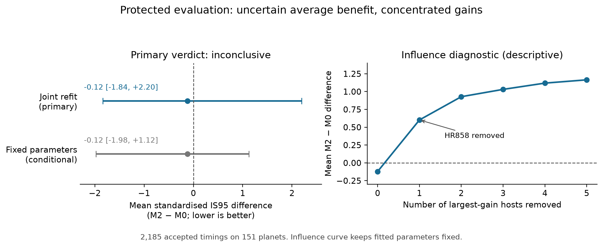

# Declared secondaries after the protected evaluation

Codex (GPT-6.1-sol), 9 November 2026. The independent D066 audit supports the
frozen primary **inconclusive** verdict: M2−M0 = −0.121, joint-refit 95%
interval [−1.84,2.20]. The analyses below do not replace it. Settings were
declared before unblinding; executable details that were not fixed are dated
in [the execution specification](secondary_execution_2026-11-09.md).
Evidence is indexed as C045–C047 in `coordination/claims.md` (D066–D067).

The work uses saved, authorised timings and likelihood grids. Frozen code,
configuration, primary outputs and the manifest remain unchanged. Three
GPT-6.1-sol delegates contributed numerical auditing, descriptive execution,
specification/source checks and sensitivity implementation; Codex integrated
the work and independently checked aggregations and conditional intervals.

## What the diagnostics show

The small negative primary mean is concentrated in a few planets. Only 40 of
151 planets improve under M2 (26.5%), and the median planet difference is
+1.045. HR858b contributes −0.720 to the original overall mean; removing its
host changes the fixed-parameter mean from −0.121 to +0.602. This is a
predeclared influence diagnostic, not an exclusion or a refitted verdict.

| Largest-gain hosts removed | Remaining planets | Mean M2−M0, fixed parameters |
|---:|---:|---:|
| 0 | 151 | −0.121 |
| 1: HR858 | 150 | +0.602 |
| 2: also TOI-905 | 149 | +0.928 |
| 3: also WASP-184 | 148 | +1.031 |
| 4: also TOI-559 | 147 | +1.119 |
| 5: also WASP-99 | 146 | +1.165 |



The left panel shows the frozen primary intervals. The right panel holds
parameters fixed and removes observed gain hosts in the declared order; it
provides no new primary decision or attribution of the joint-bootstrap tails.

The exploratory extension has one gain host, TOI-178. Removing it changes its
point mean from −11.186 to +3.367. There are no further gain hosts to remove;
k=2–5 are explicitly unavailable. Its five accepted planets and 1,989 defined
joint draws out of 2,000 remain insufficient for precise conclusions.

## Strata and recovery

All intended events fall within the earlier protocol's `(0,1]`-year lead
band. The later bands are empty, rather than merged or replaced with new
cutpoints. All scored events have the reconstructed `C2_candidate` tier and
SPOC product type. These dimensions therefore provide no between-stratum
contrast; C2 does not mean that a joint covariance was issued.

Brightness summaries use the existing development validation bins, explicitly
adopted for protected reporting after unblinding, and retain continuous
per-planet values. All seven score/coverage/width metrics, empty cells and
counts are in `results/final_secondaries/descriptive/scores_by_stratum.csv`.
Within every cell, events are averaged within planet and planets equally.
Primary, exploratory extension and combined descriptive rows are labelled.

Primary recovery is 2,185/3,103 = **70.42%** of intended metadata opportunities.
At prediction-qualified coverage it is 2,181/2,369 = **92.06%**. Four accepted
timings have unqualified coverage at the prediction and remain scored:
prediction coverage is a recovery diagnostic, not an acceptance gate. It does
not establish whether an actual displaced transit was observable or missed.
The five intended primary planets with no accepted timings remain in recovery
counts but cannot contribute timing scores.

## Dated current-catalogue TTV diagnostic

An independent metadata query, selected without seeing scores or host ranks,
matched all 184 frozen targets to current NASA Exoplanet Archive default
parameter rows on 9 November 2026. Eight are flagged and 176 catalogue-unflagged;
physical TTV status remains unknown for unflagged rows. The [archive's flag
definition](https://exoplanetarchive.ipac.caltech.edu/docs/API_PS_columns.html)
is narrower than all timing anomalies. Parameter-set dates are not TTV
discovery dates, and whether knowledge arose after the forecast origin is
unknown. Sources, queries, the one official alias mapping and hashes are in
`results/final_secondaries/ttv/SOURCE_NOTE.md` and `provenance.json`.

| Set / current catalogue label | Accepted planets | Accepted / intended events | M2−M0 point contrast |
|---|---:|---:|---:|
| Primary / flagged | 3 | 122 / 161 | −36.666 |
| Primary / unflagged, physical status unknown | 148 | 2,063 / 2,942 | +0.619 |
| Exploratory / flagged | 2 | 57 / 168 | −34.039 |
| Exploratory / unflagged, physical status unknown | 3 | 15 / 123 | +4.050 |

The primary flagged group consists of HR858b, WASP-18b and WASP-43b; almost
all of its mean-score gain is HR858b's. These are sparse descriptive groups,
not a claim of causal explanation, complete TTV classification or new
post-origin discovery. No label changes the origin-defined cohort or primary
result. The [Planetary Systems dataset](https://doi.org/10.26133/NEA12) and
official column/alias documentation support this dated catalogue diagnostic.

## Closed sensitivity comparisons

All fits use development outcomes only. Covariance and measurement-scale
settings apply on both fitting and evaluation sides; C2/majority restrictions
are applied on both sides, with the original intended denominators retained
or separately reported. All-SPOC uses the frozen broader calibration population.
Journal eligibility uses predicted events, not measured residuals. Non-Gaussian
likelihood coordinates scale with sigma while masses and measured mid-times
stay fixed. All fits converge and none reaches a parameter bound.

The table's intervals are **conditional on each scenario's fitted parameters**:
B=10,000 paired host resamples, seed `20261109`. They omit calibration-fit
uncertainty and are not the primary joint-refit interval. No secondary
improves/worsens/inconclusive decision is assigned. The common M0 denominator
is recomputed within each setting, so standardised magnitudes should not be
compared across settings as if their loss weighting were identical.

| Setting | Accepted events / planets | M2−M0 standardised | Conditional 95% interval | Raw IS95 difference, min |
|---|---:|---:|---|---:|
| Frozen baseline | 2,185 / 151 | −0.121 | [−1.975,+1.124] | −8.460 |
| Correlation zero | 2,185 / 151 | −0.121 | [−1.975,+1.125] | −8.468 |
| Correlation −1 | 2,185 / 151 | −0.723 | [−5.926,+2.476] | −22.803 |
| Correlation +1 | 2,185 / 151 | +0.346 | [−1.058,+1.279] | −5.982 |
| All-SPOC calibration | 2,185 / 151 | +0.640 | [−2.143,+2.400] | −11.413 |
| Journal anchor | 1,710 / 122 | −0.477 | [−2.786,+1.072] | −11.249 |
| C2 only | 2,185 / 151 | −0.121 | [−1.975,+1.124] | −8.460 |
| Outcome scale 1/1.1 | 2,185 / 151 | −0.408 | [−2.319,+0.917] | −8.962 |
| Outcome scale ×1.1 | 2,185 / 151 | +0.085 | [−1.712,+1.252] | −7.992 |
| Majority product gate | 2,147 / 151 | −0.104 | [−1.980,+1.155] | −8.509 |
| t015v3c, failed-confirmation rule | 2,185 / 151 | −0.422 | [−2.300,+0.880] | −9.056 |

C2-only changes neither calibration nor evaluation membership in this selected
sample. All-SPOC expands training from 206 to 216 planets and changes the point
fit M2 s from 2.047 to 2.465. The majority gate removes 18 accepted development
timings and 38 protected timings, keeping all 3,103 original opportunities.
The journal sensitivity has 2,461 eligible intended events and 1,710 accepted;
it retains the original exclusions and a stated ten-minute numeric boundary
screen, without claiming exact time-system conversion.

The standardised point contrast ranges from −0.723 to +0.640 across settings.
Every reported conditional interval spans zero. These facts describe
sensitivity of point comparisons; they do not establish robustness of a new
joint-refit verdict. Raw and forecast-normalised scores, negative log scores,
coverage and widths for M0–M3 remain in the full machine-readable summaries.

## Reproduction and checks

```bash
UV_NO_CACHE=1 .venv/bin/python scripts/final_secondary_descriptives.py
.venv/bin/python scripts/final_ttv_labels.py
UV_NO_CACHE=1 PYTHONDONTWRITEBYTECODE=1 .venv/bin/python scripts/final_sensitivities.py --workers 6
.venv/bin/python scripts/check_final_secondaries.py
MPLCONFIGDIR=/private/tmp/transit-final-review-mpl .venv/bin/python scripts/plot_final_review.py
```

The TTV command defaults to an offline rebuild of saved metadata. The
six-worker sensitivity run took about five minutes. Bulk event-score caches
are regenerable and ignored under `data/derived/final_secondaries/`; compact
summaries, planet tables and hashes are committed. Receipts record the checkout
base and actual working-source/input hashes; the scripts were authored after
unblinding, not loaded from the original frozen source commit.

A separate checker reproduces every scenario's equal-planet aggregation and
conditional interval from the saved event caches. Baseline and broader-training
fits reproduce their frozen counterparts exactly. Independent normal calculations
verify 19,240 Gaussian M0 scenario standardised scores within 2.3e-13. Seven sensitivity and
nine descriptive synthetic tests cover scaling, covariance, grouping, majority
status equivalence, metadata eligibility, empty cells and label matching. The
frozen manifest still verifies unchanged.

The article and two-page brief remain the dated development drafts; integrating
these audited results into those products is the next writing tranche.
