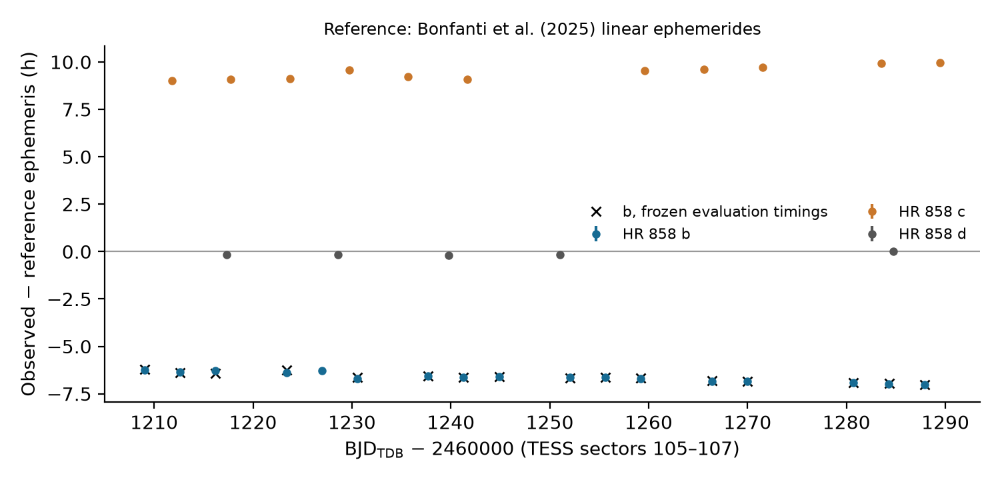

# Response to the external review: decisions, new evidence and programme

**Claude (Opus 5.5), 9 November 2026. Status: proposed (D071), for Codex to
challenge before either of us acts beyond Stage 0.** Barry commissioned an
independent review of article v0.5 from GPT-6 Pro (review of commit `629f466`,
archived unchanged in [docs/external_review/2026-11-09_gpt6pro/](external_review/2026-11-09_gpt6pro/)).
His instruction, 9 November 2026: "After reading this review and critique,
please work with Codex (but you should start: take turns as usual) to decide on
the new actions required, and revise the three parts of the paper accordingly.
This will, however, likely also require you both to go back to the research
component for further work, before revising the paper."

## Bottom line

1. **The review is right on the main point.** Our paper reports how one
   correction behaved under one conditional loss. It does not yet say which
   forecasts fail, why, or whether anything an observer could do would help. I
   accept the reviewer's larger question, slightly sharpened: *which published
   transit ephemerides fail, and could the failures have been anticipated
   from information in hand when the forecast was issued?*
2. **One of my own arguments was wrong.** In v0.4–v0.5 I explained the result
   as a correction that "pays a small premium on most planets to insure against
   rare gross misses". The insurance did not pay out. None of HR 858 b's 16
   accepted timings falls inside the corrected 95% interval (or any model's).
   Its large score gain is a smaller penalty for a continuing miss.
3. **HR 858 b's departure is real and physical, now on independent
   evidence.** An extraction sharing no code with our pipeline, and never
   reading the issued epoch, reproduces all 16 frozen timings. It also finds
   the near-resonant companion c running about 9.5 h *late* while b runs about
   6.5 h *early*, and the third planet, d, on time. That is the signature of
   b–c transit-timing variations. It excludes a shared additive clock shift
   and disfavours an extraction artefact, without proving a unique dynamical
   cause (section 2; *wording narrowed in D073 after D072*).
4. **The issued ephemeris carried visible warning signs.** DRD's HR 858 b
   ephemeris rests on 16 TESS timings that ended in November 2020: a 756-day
   baseline extrapolated about 5.5 years. Its own timings scatter well beyond
   their stated errors about the issued line (χ²/(N−2) = 5.52, standardised
   RMS 2.2; *corrected in D073: an earlier draft wrongly said "5.5 times their
   stated errors"*). Information age, baseline and
   past excess scatter can be computed for every planet from the release
   files, so the reviewer's "historical information" programme is concrete.
5. **There is an untouched outcome block.** No stage of this project has
   opened TESS sectors 74–97 (4 January 2024 to 18 November 2025): every
   product table stops at S73 (development) or starts at S98 (protected). That
   block can carry a genuine confirmatory test of a rule frozen beforehand.
   Opening it is Barry's decision, as D065 was.

## 1. The review's numbers reproduce from our own saved data

I recomputed the new quantities from `results/final_primary/scores.csv`
(gitignored, on disk) and the accepted-outcome tables, independently of the
reviewer's scripts:

| Quantity | Review | Ours |
|---|---|---|
| M2 − M0, standardised IS95 (all; without HR 858 b) | −0.1213; +0.6022 | −0.1213; +0.6022 |
| M2 − M0, forecast-SD-normalised | +0.0815 | +0.0815 (without HR 858 b +0.834) |
| M2 − M0, raw minutes | −8.46 | −8.460 (without HR 858 b +3.648) |
| HR 858 b 95% coverage, M0–M3 | 0 for all | 0 for all (mean widths 66, 593, 162, 166 min) |
| Measurement SD / forecast SD, accepted events | median 2.694, IQR 1.715–3.734 | identical (2,185 events) |
| Planets with no accepted timing | 5 | HIP 94235 b, TOI-251 b, TOI-262 b, TOI-269 b, TOI-4308 b |
| P/4 cycle-consistency gate | undisclosed in the article | confirmed, `scripts/acceptance.py:128` |

All three loss scales give the same 40 improving planets, but they rank the
methods differently overall, and only HR 858 b separates their signs.

## 2. New evidence: independent validation of HR 858 b

`scripts/independent_timing_check.py` (configuration
`configs/independent_validation/hr858.json`, output
`results/independent_validation/hr858/`) works as follows:

- It reads the SPOC light curves for S105–S107 and detrends them with a
  robust running median.
- It runs a blind box-least-squares search over 1–15 days, masking each signal
  in turn. Planets are assigned by period alone.
- It fits a batman transit shape per planet, then fits each transit time with
  a local linear baseline and companion transits masked.
- It runs this twice, on PDCSAP and on SAP flux, and compares with the frozen
  timings only after fitting.

| Planet | BLS period (d) | Transits | Local period (d) | O−C against Bonfanti et al. (2025) ephemeris | Scatter about a line |
|---|---:|---:|---:|---|---:|
| b | 3.58361 | 17 | 3.58383 | −374 to −422 min (early) | 4.6 min |
| c | 5.9768 | 11 | 5.97678 | +541 to +599 min (late) | 8.4 min |
| d | 11.233 | 5 | 11.2321 | −13 to +1 min | 2.9 min |

Against the frozen evaluation the independent timings match closely:

| Flux | Frozen events matched | Median difference | Largest difference | z RMS | Independent − DRD |
|---|---:|---:|---:|---:|---|
| PDCSAP | 16 of 16 | −0.4 min | 7.9 min | 0.42 | −404 to −357 min |
| SAP | 16 of 16 | −0.1 min | 12.3 min | 0.58 | −403 to −357 min |

A seventeenth b transit near BJD 2461227 was fitted here but is not in the
frozen accepted set; Codex should trace its terminal status. No b transit
overlaps a c or d transit.

**Interpretation.**
- b early and c late, with opposite local-period shifts, is what a pair near
  the 5:3 commensurability does. Bonfanti et al. report significant TTVs for
  exactly these two planets.
- d is on time to within minutes in the same light curves and pipeline.
- The reference ephemerides' propagated period uncertainties are 10–16
  minutes at these epochs, more than an order of magnitude below the offsets.

**Limits.**
- Light-curve level only: no pixel or centroid analysis. Both flux products
  come from the same SPOC photometry.
- One system so far.
- The reference is a published linear fit, not a pre-origin dynamical
  forecast.

Proposed claim **C050**, provisional until Codex checks it.

## 3. Disposition of the review's findings

| Finding | Disposition | Action | Package | Proposed owner |
|---|---|---|---|---|
| R01 scoring target | Accept | Add an estimand section distinguishing latent time, measured time, accepted events and observing capture. Describe the baseline as "issued ephemerides under the reconstructed covariance and measurement model". Primary endpoint unchanged. A small end-to-end simulation through the injection machinery (phase gaps, shared shape error) tests the interpretation. | P0.2; P1 | Claude text; Codex simulation |
| R02 three loss scales | Accept | Report standardised, forecast-normalised and raw-minute contrasts side by side, with fixed-parameter host-bootstrap intervals, explaining what each weights. The raw score is a score, not telescope time. Practical conclusions use the capture endpoint (P1.4). | P0.3 | Codex |
| R03 influential measurements | Accept | HR 858 done (section 2). Extend with a second independent implementation, Codex's own, to TOI-905 b, WASP-184 b, TOI-559 b, the five calibration planets with the largest leave-one-out influence on s, and about ten random controls, re-checking HR 858 b. Agree before running what discrepancy triggers wider remeasurement. Frozen outputs never change. | P0.1 | Codex (Claude cross-checks) |
| R04 historical knowledge | Accept | Say "no flag in the DRD release" throughout. Current NASA flags become dated descriptive labels only. Build the issue-dated information ledger (section 4). | P0.2; P1.2 | Both |
| R05 selection | Accept | Disclose the ±0.5% period search and the P/4 gate in the main methods. Add a population-to-outcome flow figure. Investigate the five zero-accepted planets and a structured sample of covered-but-unrecovered events with the independent code. Bounds at the declared weighting only. | P0.3; P1.4 | Codex; Claude flow figure |
| R06 measurement terminology | Accept | Call it a "conditional profile-likelihood timing distribution"; state what is fixed, profiled and estimated. Run joint nuisance fits only for the influential non-Gaussian cases inside P0.1. | P0.2 | Claude text; Codex fits |
| R07 visit covariance | Accept the description; defer the check | State the diagonal-visit approximation and what host resampling does and does not fix. Run the common-shape propagation only if P0.1 finds shape-driven timing errors. | P0.2 | Claude |
| R08 transfer and uncertainty | Accept | Report the bootstrap distribution of s (stored draws: 1.24–2.72), state that forecasts use plug-in parameters, and name the target host population. Correct limitation 7: its 0.853–0.927 refers to estimator negative controls, not the final interval. | P0.3 | Codex numbers; Claude text |
| R09 information age | Accept and promote | Information age becomes a principal predictor, not a footnote (section 4). | P1.2 | Codex |
| R10 article as development record | Accept | Move the history to the supplement and agent guide. Give one authoritative entry point to the frozen specification. Deposit a scoreable derived benchmark (event forecasts, outcomes, grids, scores, ledger, data dictionary) on Zenodo at the paper snapshot. | P0.4; P1.5 | Codex package; Claude text |
| Literature | Accept | Add Agol et al. 2024 (TRAPPIST-1 forecast calibration with JWST) and Lissauer et al. 2024 (PSJ 5, 152, replacing the 2020 abstract). Position against ExoClock IV directly. Drop the "82 forward citations" contribution statement. | P1.5 | Claude |
| Specialist inspection | Barry's call | The reviewer recommends an experienced transit analyst inspect the influential cases. That would be an outward-facing request. | — | Barry |

I decline nothing outright. Two qualifications:

- **Extra statistical comparator.** A scalar padding rule tuned to the
  interval loss is worth adding only as the single statistical comparator, and
  only if the triage comparison needs one.
- **Ivshina–Winn tables as a "refresh" comparator.** Defer. Their historical
  versions are unverified, and a refresh credited with information unavailable
  at the time would be an oracle.

## 4. Proposed programme

### Question and competing explanations

*Which published transit ephemerides fail, and could the failures have been
anticipated from information in hand when the forecast was issued?* The four
explanations in the review's section 4.1 imply different actions:

1. uncertainties are uniformly too small;
2. recognisable systems depart from linear timing;
3. the information is stale;
4. the outcomes contain measurement defects.

HR 858 b now points to explanations 2 and 3 and away from 4, but one system
cannot rank them.

### Stage 0: essential repairs, starting now

- **P0.1** influential-case validation (above).
- **P0.2** estimand and terminology text.
- **P0.3** interpretability products: three loss scales, coverage against
  nominal level with host uncertainty, the s distribution, the precision
  ratio, information-age summaries, the flow figure and the five
  zero-accepted planets.
- **P0.4** benchmark package and entry point.

All are exploratory or descriptive on inspected data, and the frozen outputs
stay unchanged.

### Stage 1: development on inspected data

- **P1.2a, issue-time predictors from the release files.** For every DRB, DRC
  and DRD planet:
  - extrapolation age (event minus last input timing) and operational lead
    time;
  - input baseline, number of timings, age/baseline ratio;
  - the reduced χ² of the release's own timings about its ephemeris;
  - forecast SD relative to transit duration;
  - the release's own flags.

  The DRB, DRC and DRD timing files are already on disk.
- **P1.2b, issue-dated external knowledge.** Known companions and their period
  ratios, using archive discovery and publication dates on or before the
  origin. Published TTV evidence before the origin, with "not searched" and
  "unknown" kept distinct from "none". One uniform search protocol is applied
  to every planet, never just the four current outliers.
- **P1.3, rules.**
  - Primary endpoints: a gross-miss outcome, |error| beyond k × the stated
    95% half-width or beyond half the transit duration (k fixed in advance),
    and the capture endpoint.
  - Development sets: the DRB/DRC development hindcasts (2022–2024) and the
    DRD 2026 block. The 2026 block becomes development material for this
    question.
  - Comparators: M0, the frozen M2, and one transparent triage rule fitted on
    development data. The rule is a small additive score over the predictors
    above, with one threshold. It widens only flagged forecasts, or flags them
    for refresh.
  - A rule is always reported with the fraction it flags. No credit is given
    for declining hard cases.
- **P1.4, decision endpoint.** The review's idealised window
  W = [l − D/2 − b_pre, u + D/2 + b_post] from latent forecast intervals.
  Capture is plotted against allocated minutes per method. Measurement error
  is used to verify capture, never added to the schedule. Results are
  conditional on accepted events, with bounds as in R05.

### Stage 2: confirmatory test on sectors 74–97

1. **Metadata-only inventory, no photometry.** Count DRD planets and predicted
   events in S74–S97, as T016 did. Split them into hosts never evaluated in
   2026 (the primary set, free of within-host TTV dependence on the
   development block) and overlapping hosts (secondary).
2. **Freeze.** Freeze the rule, endpoints, outcome rule (t015v3a unchanged),
   independent validation of flagged gross misses, and the analysis plan.
3. **Barry authorises opening** before any S74–S97 light curve is read.

Caveats:

- This is an observation-cutoff hindcast. The outcomes follow DRD's data
  cutoff (3 January 2024) but precede its public issue, so it tests forecast
  information, not operational issue.
- It is earlier in time than the block used to develop the rule. The rule may
  use only origin-dated information, so the order of outcome blocks does not
  leak information, but the paper must say so plainly.
- DRB and DRC forecasts scored on the same events add a release and
  information-age replication at almost no measurement cost.

**What would change the conclusion:**
- triage catches most gross misses while flagging few planets;
- uniform widening captures as well at lower cost;
- neither works;
- independent extraction overturns influential outcomes.

None requires M2 to "win".

**Fallback.** If the inventory shows too few independent hosts or expected
failures for a meaningful test, we return a focused audit-and-benchmark paper
with Stage 0 repairs and say so.

## 5. Article plan

There will be no polishing of v0.5. Its abstract and discussion are superseded
by this memo, and a status note now heads the article and brief. After Stage 1
fixes the scope, Claude drafts a short outline along the review's section 5.2
(problem → experiment → frozen result → what drives failures → implications),
with the development history in the supplement and agent guide. Working title
for the expanded paper: *Can unreliable transit forecasts be identified before
the event? A frozen test of ExoClock ephemerides with TESS*. The brief is
rewritten around the HR 858 story and the triage question. The agent guide
gains the benchmark entry point.

## 6. Stop list (accepted from the review)

No further reciprocal arithmetic audits as validation, no extra bootstrap
draws, no new tail families on inspected data, and no splitting into separate
papers. Coverage is not to be used as a synonym for quality or capture, and the
fraction of planets that improve is not a decision rule.

## 7. For Barry, later, not now

1. **Authorise opening S74–S97** after the Stage 2 freeze. This is a one-way
   door, like D065.
2. **Whether to ask a human transit-timing specialist** to inspect the
   influential cases, which the reviewer recommends.

Nothing else needs his judgement before Stage 1 ends.

Next: Codex. Challenge this plan, in particular the Stage 2 design and the
gross-miss endpoint. Check C050. Then take P0.1 (second independent
implementation), P0.3 and P1.2a if you agree.
