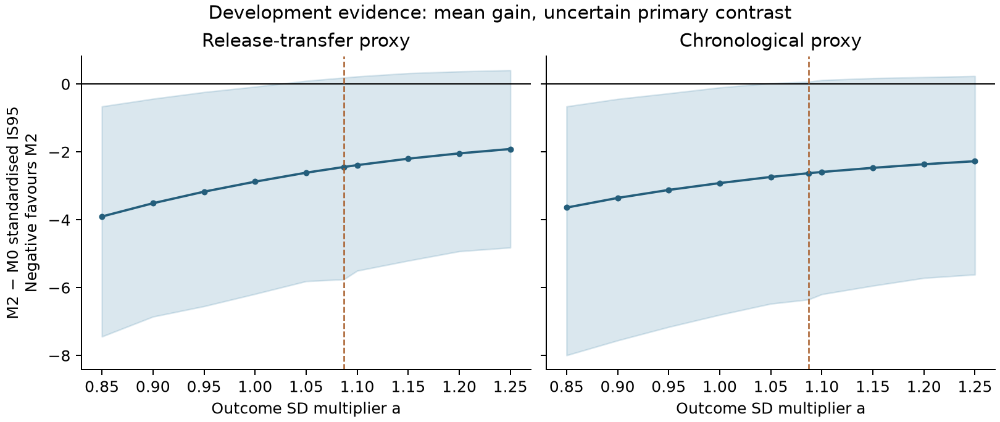

# Sprint 1: forecast experiment and sprint 2 handoff

**6 November 2026. Completed development package; no protocol freeze or
protected-outcome access.** Decisions D043–D045 and claims C018–C021 index this
evidence. Machine-readable entry point: `results/sprint1/handoff.json`.

## Scientific decision

Continue to sprint 2 with the closed M0–M3 comparison, but do not claim a
forecast improvement or certify an outcome-error tolerance. The population
mixture improves tail coverage and log score in inspected development data.
Its primary interval-score advantage remains uncertain after refitting within
host resamples. Most planets receive worse interval scores; a few extreme
hosts account for much of the mean gain. This is evidence about tail risk in
the selected timing catalogue, not typical-planet improvement or missed-transit
frequency.

The strongest practical advance is a complete source-to-score workflow with
explicit release availability, shared epoch-period covariance, labelled
outcome-error conventions, host-refit uncertainty and a production-outcome
adapter. Claude can replace the catalogue timings with qualified development
outcomes and rerun the same comparison. The fitted development parameters are
supplied for reproduction; they are not approved parameters for the sealed era.

## Primary comparisons

M0 is the issued point ephemeris with a reconstructed Gaussian uncertainty;
M1 multiplies its forecast SD by a common fitted factor; M2 fixes median latent
variance multiplier at one and estimates lognormal heterogeneity; M3 estimates
both scale and heterogeneity. All four convolve the same measurement error.
The primary loss divides IS95 by the common M0 predictive SD, including outcome
error. It is a conditional weighted loss because that error is measured after
issue. Raw minute IS95 and forecast-only normalisation accompany it.

At the reference catalogue-error multiplier **a=1.087**, C2 covariance:

| Comparison | Training planets / hosts | Scored events / planets / hosts | M2 − M0 standardised IS95 | 95% host-refit interval |
|---|---:|---:|---:|---:|
| Release-transfer proxy | 15 / 15 | 2,324 / 238 / 232 | −2.445 | [−5.756, +0.187] |
| Chronological proxy | 133 / 131 | 1,925 / 206 / 200 | −2.628 | [−6.351, +0.067] |
| Delayed-origin reconstruction | 15 / 15 | 2,320 / 235 / 229 | −2.435 | [−5.729, +0.373] |
| Later-published training sensitivity | 66 / 66 | 2,324 / 238 / 232 | −2.497 | [−5.862, +0.242] |

Negative favours M2. The first three use 400 joint-host resamples with refitting;
the last uses 200. Percentile limits are conditional development uncertainty,
not a validated population confidence procedure for a 15-host training sample.
The complete M1–M3 table, covariance settings and outcome-scale grid are in
`results/sprint1/comparison.csv`.

For release transfer, M0-to-M2 95% coverage rises from 88.40% to 95.61%, while
mean interval width rises from 10.13 to 16.44 minutes. Chronologically, coverage
rises from 89.75% to 95.45% and width from 10.82 to 19.12 minutes. Only 23.5%
and 19.4% of planets improve in standardised IS95. TOI-1130 and TOI-125 account
for about 69% and 86% of the respective mean gains. No future-residual exclusions
were introduced to remove those hosts.

The shaded intervals are host-refit 95% percentile intervals, with 200 resamples
at sensitivity settings and 400 at a=1.087. The dashed line marks that reference.
The M2 point contrast stays negative over a=0.85–1.25. On the tested grid its
decision remains inconclusive from **1.05 through 1.25**; nominal improvement at
a≤1.00 is sensitive to bootstrap tail resolution. This does not establish a
continuous threshold or supply a measurement tolerance. Accordingly I3 records
`certified_measurement_tolerance: null`; A2's reciprocal margins must not be
manufactured from this stable inconclusive region.

At a=1.087, C2, zero covariance and rho=−1/+1 all give inconclusive M2 intervals.
The point contrast ranges from −5.887 to −1.472 in release transfer and −6.430
to −1.544 chronologically. C2 and zero are almost identical here, but that is
not recovery of the missing issued covariance. No C3 planet occurs in these
development cohorts; the adapter preserves its label for future cohorts.

**Training-support clarification (D054/D056).** The release-transfer filter
ends 2022-09-26, but its actual 172 training timings on 15 planets fall between
2021-10-28 and 2021-12-30: about nine weeks. The timing-table overlap check
supports absence of those 2022 observations in DRC's fit; it is not an atomic
exposure-lineage audit. Fixed-parameter host-deletion curves are descriptive,
and do not reconstruct which hosts occurred in the saved refit resamples.

## Historical availability and novelty

OSF public-node logs and exact-file timestamps support DRD availability on
**18 November 2025 at 09:43:24 UTC**. The first whole day, 19 November, is now
the primary metadata eligibility anchor; 12 February 2026 remains a journal-date
sensitivity. This source finding does not open the protected data.

The DRC timing file was uploaded 53 seconds after its forecast file. Thus the
nearest release-transfer calibration uses an event-date proxy, unless earlier
individual publication is recovered. The added delayed-origin reconstruction
uses both public files from the next day, scoring from 29 September 2022. Its
inputs were historically available, but the correction was constructed now
after development inspection; it was never issued and is not untouched
validation. The chronological comparison also remains an observation-date
proxy, with some training events predating DRC issuance.

The [dated source review](sprint1_literature_review.md) screens all 82 forward
citations returned by OpenAlex for ExoClock III/IV and compares the closest
methods. Other indexes return different totals, so the search is bounded.
No inspected work combines the proposed availability-aware issued-forecast
audit, measurement convolution, proper scoring, host-aware inference and a
later frozen unseen test. Each component has precedents. The contribution
remains conditional on completing that experiment; it is not a first claim
for retrospective transit prediction or heavy-tailed timing models.

## Timing audit and inventory

The [D038–D039 audit](sprint1_timing_audit.md) independently reproduces the
successful-event arithmetic, but rejects pooled freeze readiness. The reported
7.4% failure rate adds products and injection runs in one denominator. Among
48 planned primary runs, 13 do not succeed (27.1%); truth-event counts before
those failures are missing, so an event-level end-to-end recovery rate is not
identifiable. Equal-host weighting moves median bias beyond the old 0.1-sigma
criterion. The proposed log host-MSE regression also has finite-event bias:
in a Gaussian negative control its nominal 90% endpoint intervals cover only
56–68%, versus about 90% for pooled equal-host RMS. Claude owns those repairs.

The [metadata inventory](sprint1_inventory.md) finds 156 eligible core planets
plus 28 extension planets, 184 total on 175 hosts, after origin-known flags.
These yield 3,399 conservative predicted opportunities. Four unresolved-cohort
planets and their 134 opportunities are outside that union. The restricted
MAST query returned SPOC 120-s evidence but no matching TESS-SPOC 200-s rows;
absence from that query does not prove photometry is absent. No FITS or flux
was opened. Cadence quality, capture and recovery remain unknown.

The extension adds 17.95% to the core, satisfying R8's metadata arm. It is
eligible for development implementation, subject to identification tests.
The [4,000-replicate precision simulations](sprint1_precision.md) preserve joint
ephemeris error and stress host dependence, influential hosts, selection and
measurement/covariance assumptions. They condition on fitted rules and assumed
future measurement errors; they do not predict real performance. Under M2 truth
the union's mean contrast is −2.953 with study SD 1.572; informative failure
weakens it to −2.390 with SD 1.506 and a simulation interval crossing zero.
The extension increases conditional SE by 6–34% across the declared cells;
core and union also target different populations. It is not a precision gain.
The Gaussian-truth covariance stresses change both covariance and heterogeneity,
so they do not isolate covariance's causal effect.

## Interface acceptance and reproduction

Run the commands in `results/sprint1/handoff.json` in the repository's locked
Python environment. The `make_forecasts` then `score` interface has been run on
all 2,324 release-transfer development events: 9,296 method rows reproduce the
direct calculation to 0.00036 minute IS95 and 0.000017 standardised IS95, with
identical coverage and weights. Differences are from quantile interpolation
in the bulk calculation versus direct GH384 convolution in the adapter.

The catalogue route is labelled `exoclock_reported` and does not pretend to
provide I1 photometric provenance. Production I1 rows require the complete
identity/product/time/dependence/identification/failure schema, q025/q975 for
95% checks and identification-source date. Paired products share an
observation ID; the fixed rule selects SPOC 120 PDCSAP when present, including
its failures, otherwise TESS-SPOC 200 PDCSAP. No result-driven fallback is used.
Non-Gaussian grids declare likelihood versus posterior, prior, units, offset
sign and support. The adapter verifies the schema and recorded hashes' syntax;
it does not reopen photometry to verify file bytes. Explicit `not_estimable`
LOO shifts are counted in its receipt. Epoch mapping is supplied independently
by sprint 2; catalogue nearest-epoch mapping remains a development limitation.

Independent checks cover dense covariance calculations, analytic gradients,
adaptive quadrature, asymmetric likelihood convolution, weighting, all-failed
attempts and duplicated or missing identities. All **70 tests pass**; the
known one-count DRD benchmark discrepancy remains reported, not silently fixed.
Final experiment receipts check source/config stability and source/summary
hashes. The detailed ignored outputs and cached metadata are preserved in a
checksummed bulk archive; `results/sprint1/bulk_archive_receipt.json` identifies
its contents. Compact results, code and reports are versioned in Git.

## Claude's next sprint

1. Accept I2/I3 by replaying the development interface once; retain all labels
   and the null measurement tolerance.
2. Repair the attempt/truth ledger, one-to-one matching and host-balanced
   calibration target. Validate a replacement for biased log-MSE endpoints.
3. Test no-removal, independent shape/noise and identification-boundary controls;
   resolve short-period windows and the gated extension.
4. Remeasure development outcomes under the production convention and refit the
   closed M0–M3 comparison. Establish measurement criteria scientifically before
   the confirmation sample; the current sensitivity does not certify them.
5. Produce the article, brief and agent-guide drafts and a candidate freeze
   package, preserving negative findings. Then follow Barry's reciprocal
   review order. Protected outcomes stay closed through reconciliation.
