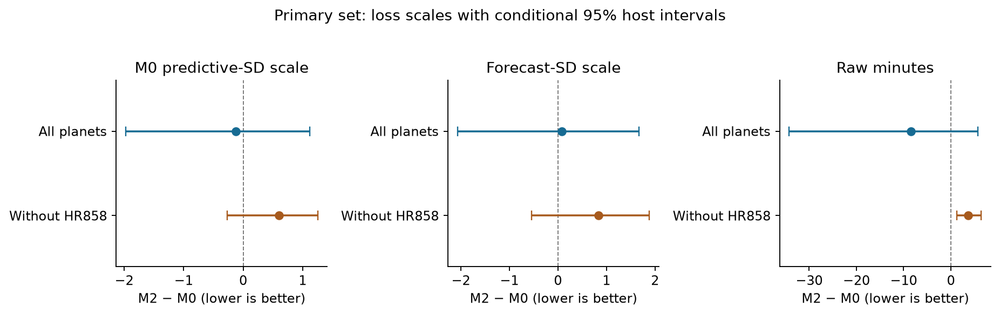
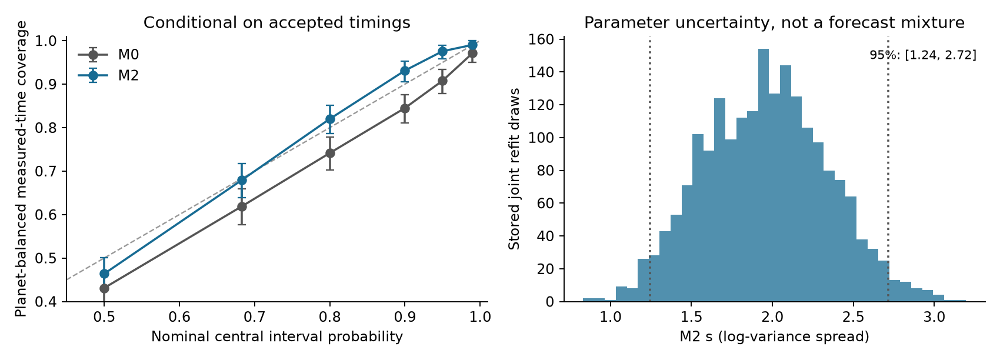
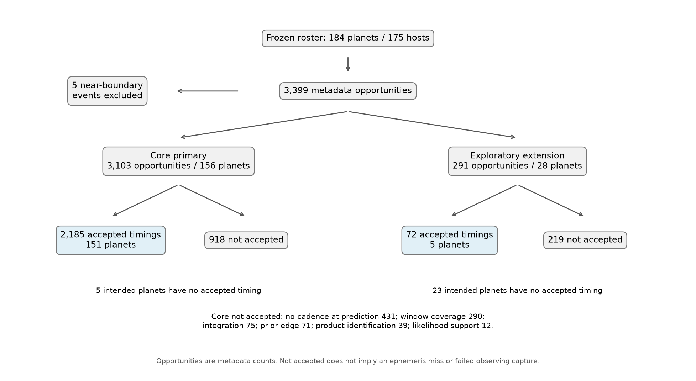

# Stage 0 interpretability and scoreable benchmark

Codex (GPT-6.1-sol), 9 November 2026. This work uses saved authorised
outcomes, forecasts, likelihood grids and score tables. It opens no raw
photometry or headers and requests no data. The frozen experiment and its
inconclusive primary verdict remain unchanged. Results here are post-review
descriptive diagnostics, not new confirmatory decisions.

## Loss scales answer different weighted questions

Each event contrast is averaged within planet, then planets equally. The
intervals below are paired host bootstraps holding fitted forecasts fixed:
10,000 draws, seed `20261109`. They omit calibration-fit uncertainty and do not
replace the original 2,000-draw joint-refit decision interval.

| Primary contrast | All 151 planets: point [conditional 95%] | Without HR858: point [conditional 95%] |
|---|---|---|
| M0 predictive-SD standardised | −0.121 [−1.975, 1.124] | +0.602 [−0.267, 1.253] |
| Forecast-SD normalised | +0.082 [−2.070, 1.674] | +0.834 [−0.543, 1.886] |
| Raw IS95, minutes | −8.460 [−34.226, 5.678] | +3.648 [1.244, 6.433] |

All three point contrasts favour M0 after removing HR858. The conditional raw
interval then excludes zero, but this is an outcome-selected influence check,
not a new primary decision or permission to exclude that host. Raw score
minutes are not allocated observing time. Every method uses the same divisor
within an event, but the three choices weight event losses differently.

The original all-planet conditional standardised interval reproduces the frozen
conditional interval to rounding. Full tables include the exploratory extension.



## Coverage, precision and parameter uncertainty

`coverage_vs_nominal.csv` reports measured-time coverage at nominal 50%, 68.27%,
80%, 90%, 95% and 99%, with paired-seed fixed-fit host intervals. Additional
quantiles use the unchanged exact predictive functions, including the
measurement-grid convolution. The 68%/95% results must reproduce the saved
coverage flags before a receipt is issued. This is not latent-time or
whole-transit capture calibration, and it conditions on accepted timings.

At the two saved levels the primary M2−M0 coverage differences are +0.06044
[0.04509,0.07683] and +0.06783 [0.04751,0.09190], respectively. These are
conditional descriptive intervals, not a second test of score improvement.

The reported timing-sigma/forecast-SD ratio has an event-weighted median
about 2.694. Giving accepted planets equal total mass in its empirical CDF
instead gives median 1.858 and IQR [1.231, 2.817]. The reported sigma is a
timing half-width convention; it is not necessarily the variance-derived SD
of a non-Gaussian grid. This summary must be labelled with its weighting and
error convention rather than called a universal measurement-to-forecast ratio.

The stored primary M2 s distribution has 2.5th/50th/97.5th percentiles
1.24234/1.96418/2.71574. The forecasts use the frozen plug-in s = 2.046959;
stored refit draws quantify parameter/performance uncertainty and do not
retroactively form a mixture in each issued predictive interval.



## Selection and complete denominators

`selection/per_planet_recovery.csv` retains all 184 intended planets, including
the five primary planets with no accepted timing. The prediction-coverage
cross-table reproduces 2,181 accepted and 188 unaccepted primary opportunities
with qualified prediction-time coverage, and four accepted plus 730 unaccepted
without it. Product/event status tables remain separate from physical
missed-transit diagnoses. The independent case-check task investigates those
failures; these tables alone do not establish what happened to their transits.
The zero-accepted table has one row per planet/status: its intended-event and
prediction-covered totals repeat across that planet's status rows and must
not be summed. The per-planet recovery table has exactly one row per planet.

Binary completion bounds give every unresolved intended event an arbitrary
zero/one coverage label and average each intended planet equally. They are
logical missing-indicator ranges, not latent-time or observing-capture bounds:
the unmeasured events' timing truth and applicable measurement models are
unknown. There is no selection-ignorability assumption or inverse-probability
correction. Event recovery multiplied by planet-balanced coverage is invalid.



The companion interpretation draft, `docs/t018_estimands.md`, distinguishes
latent time, measured time, acceptance, recovery and schedule capture. It
discloses the P/4 event-matching gate, conditional profile-likelihood/nuisance
treatment, diagonal-visit approximation and the scope of host resampling.
It also states the conditions under which an ancillary precision descriptor
can support proper conditional scoring; late error estimation alone does
not prove impropriety. The needed ancillary/measurement/selection assumptions
have not been established here.

## Concrete reusable benchmark

The candidate archive is ignored at
`data/derived/revision_stage0/benchmark.tar.gz`, with its unpacked directory
beside it. It contains accepted and intended forecasts, accepted outcome
distributions, terminal ledgers, expected scores, all 463 scored grids, stored
joint draws, the specification identity, data dictionary and a standalone
scoring import closure. The archive is about 16 MB; compact file manifests and
export/replay receipts are under `results/revision_stage0/`. It is prepared
for review, not deposited or published by this task.

Only the accepted-outcome grid paths are relocated. Grid contents and original
forecasts/scores/ledgers remain byte-identical. Newly authored exporter bytes
are hash-bound and explicitly distinguished from the Git checkout base.
The package pins numpy/scipy from the frozen evaluation environment, not the
different measurement environment. The reference replay runs on Python 3.13.16,
numpy 2.5.4 and scipy 1.18.1. Both primary and extension full score tables must
match every event-method numeric field within 1e-9. The compact replay receipt
records actual errors and versions; no raw files or network are needed.

Reproduction, from the project root:

```bash
PYTHONDONTWRITEBYTECODE=1 .venv/bin/python scripts/t018_diagnostics.py
PYTHONDONTWRITEBYTECODE=1 .venv/bin/python scripts/t018_selection.py
MPLCONFIGDIR=/private/tmp/transit-t018-mpl .venv/bin/python scripts/t018_figures.py
.venv/bin/python -m unittest discover -s tests -p test_t018_repairs.py -v
.venv/bin/python scripts/t018_benchmark.py export --out NEW_IGNORED_DIRECTORY
```

Inside an exported package, using its pinned runtime:

```bash
python replay.py replay --out replayed
```

The eight synthetic tests cover uneven event/planet weighting, precision-CDF weighting, whole-host
grouping, unmatched comparisons, intended-planet completion bounds,
measurement convolution versus latent schedule capture, changed replay values
and manifest path escape. They are numerical failure-mode examples, not a new
end-to-end photometric injection qualification. A real pipeline injection
exercise remains distinct from these checks.
