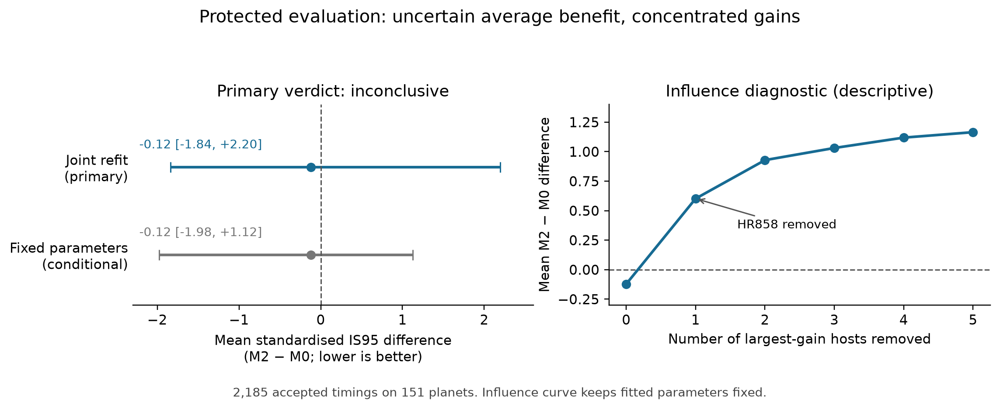
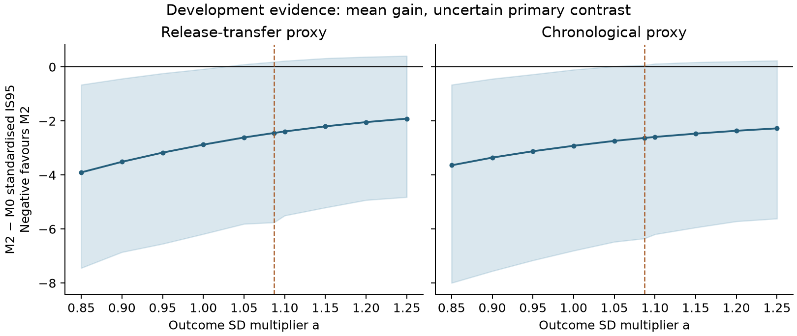
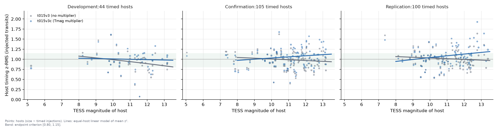

<!--
DRAFT STATUS. Repository draft, not a submission. Written to be rebuilt from the living repository: every number carries a claim ID from coordination/claims.md.
Held-out claims: C043 primary protected evaluation; C044 exploratory extension; C045 independent audit; C046 strata, recovery, influence and TTV labels; C047 sensitivities; C048 descriptive HR858b check; C049 interval-score interpretation. Freeze: C038–C042 (rule, final path, package). Development claims as cited in Section 4.
Missing citations are written [CITATION NEEDED: ...]. Bibliography entries are written from verified DOI metadata (references/); Barry's DOI sweep precedes release.
-->

> **Under revision (D071, 9 November 2026).** An external review found that this draft reports one correction under one conditional loss without asking which forecasts fail or why. Its discussion also misreads HR 858 b, whose accepted timings lie outside every model's 95% interval. The revision plan is in [docs/review_response_2026-11-09.md](../docs/review_response_2026-11-09.md). The frozen result below is unchanged.

# Abstract

**Question.** ExoClock publishes linear transit ephemerides with timing uncertainties. We ask whether those uncertainties describe later, independently measured TESS transit mid-times, and whether a population calibration learned from the previous release improves the predictive distribution of the next one.

**Design.** We froze a hash-bound protocol (75 files and 780 likelihood grids) before opening any TESS photometry from after the DRD release (18 November 2025). It fixed the cohort, the issued DRD forecasts, a forecast-independent outcome rule qualified on injected transits, a calibration fitted only to the earlier release's errors, the scoring and the decision rule (C038–C042). The primary contrast is the planet-balanced change in the standardised 95% interval score between the issued Gaussian forecast (M0) and a tails-only calibrated forecast (M2), with a 95% interval from 2,000 joint host resamples that refit the calibration in each draw.

**Primary result: inconclusive.** Of 3,103 predicted opportunities on 156 single-catalogue-planet hosts, 2,185 transits of 151 planets were measured and accepted. M2 − M0 is −0.121, 95% interval [−1.84, 2.20] (C043). The interval spans substantial benefit and substantial harm; the data establish neither, and they do not establish equivalence. Independent aggregation reproduces the contrast and stored-draw intervals, with separate bounded checks of scoring and refitting (C045).

**What the calibration does.** The issued 95% intervals cover 90.8% of measured outcomes (planet-balanced). M2 raises this to 97.6% while widening the mean 95% interval from 10.5 to 17.5 minutes (C043). Only 40 of 151 planets score better; the median planet difference is +1.05, against the less favourable direction. One planet, HR 858 b, whose transits arrived about 6.3 hours earlier than the issued ephemeris predicted against a quoted 16-minute uncertainty, supplies most of the average gain: holding parameters fixed, removing its host moves the mean from −0.121 to +0.602 (C046). Across ten declared sensitivity settings the point contrast ranges from −0.72 to +0.64 and every conditional interval spans zero (C047). A small exploratory extension to multi-planet and long-period hosts (5 planets) is uninformative (C044).

**Interpretation.** Most accepted timings lie within the issued 95% intervals, but observed coverage is below nominal and some departures are tens of quoted standard deviations. The calibration increases coverage and width, with score gains concentrated in a few planets. Neither average score benefit nor harm is established. These conclusions condition on successful timing; they do not assess missed transits or establish an effective targeting policy. Concentrated gains also appeared in development data (Section 4).

# 1. Introduction

Planning a transit observation requires a predicted mid-time and an honest statement of how wrong it may be. Ephemeris catalogues supply both. A user who schedules telescope time, or a space mission that must point at a window, relies on the quoted uncertainty being a calibrated description of future error. Whether it is has been tested less often than the ephemerides have been refitted.

**Prior work.** ExoClock IV compares DRB, DRC and DRD predictions with later TESS timings in its Section 5.1 and Table 5, and states that the DRD comparison is optimistic because those timings entered that release [@Kokori2026ExoClockIV]. The release series is documented in @Kokori2022ExoClockI, @Kokori2022ExoClockII and @Kokori2023ExoClockIII. Shan et al. compare an archive of predictions with TESS timings for 262 hot Jupiters and then study 31 discrepant systems [@Shan2023TESSTimings]. Large TESS timing compilations and ephemeris refits supply alternative outcome products [@IvshinaWinn2022; @Mallonn2019; @Edwards2021ORBYTS; @Wang2024PeriodVariation]. Kaye and Aigrain propagate epoch-period covariance into forecasts for Kepler and K2 planets [@KayeAigrain2025], following the pivot argument of @Deeg2015. @Dragomir2020 model how ephemerides degrade with time, and @Lissauer2020Ephemerides document unreliability from timing variations. @Eastman2010 set the time-standard conventions we rely on. Proper scoring rules and the calibration-sharpness framework are standard [@GneitingRaftery2007; @GneitingBalabdaouiRaftery2007]. ExoEcho I's HST timing analysis, with leave-one-out refits and an enlarged error floor for influential points [@Ma2025ExoEchoI], and Student-t transit-timing likelihoods [@JontofHutter2016; @Agol2021TRAPPIST1] are the other closest methods we screened.

**What this work adds, and what it does not.** Retrospective validation of old ephemerides against later timings is not new, and neither are covariance propagation, heavy-tailed timing models or proper scores. The contribution is a combination, now executed on a held-out block. It joins five features that we did not find together in the 82 forward citations of ExoClock III and IV returned by OpenAlex (a bounded search; other indexes return different totals): (i) exact issued ephemeris files with documented public-availability times; (ii) probabilistic scoring of measured outcomes with forecast and outcome uncertainty kept distinct; (iii) a proper interval score as the primary comparison; (iv) planet-balanced summaries with host-cluster uncertainty; and (v) a calibration trained before, and applied unchanged to, a later block that the investigators have not inspected (C019, `docs/sprint1_literature_review.md`).

**Retrospective evaluation as method.** The design follows the logic of Brook et al., who estimated population-viability models on the first half of long ecological time series and scored their predictions on the second half [@Brook2000PVA]. The physical processes differ. The shared principle is that a model's stated uncertainty is a hypothesis about its future errors and should be tested on replicated, later data.

**Central question.** For the DRC and DRD releases, do the issued uncertainties support their intended interpretation for later independent TESS mid-times, and does a calibration learned from the earlier release improve the predictive distribution? The prespecified primary contrast is the planet-balanced change in the standardised 95% interval score between the issued Gaussian forecast and the tails-only calibrated forecast (M2 minus M0).

**Scope of evidence.** The article is a snapshot of a living repository. Section 3 reports the held-out evaluation: TESS outcomes after 2025-11-18, first opened after the protocol was frozen and authorised (D065), scored once by the frozen code. Section 4 reports the development evidence that shaped the protocol: TESS outcomes dated 2022-01-01 to 2024-01-03, all inspected during design, none of which can serve as untouched validation (D014). Secondary analyses of the held-out block that were declared before unblinding but implemented after it are labelled as such (D067).

# 2. Methods

## 2.1 Cohort and release availability

The forecast products are the DRB, DRC and DRD ephemeris catalogues deposited on OSF (DOIs in Data availability). We treat each file as an issued forecast and record, separately for each, the end of its input observations, the first verified public availability, the forecast origin used in our analysis and the retrieval time.

Availability comes from OSF API logs for the node and for each exact file. Under the assumption that a file present in an already-public node, or added to one, is retrievable at the later of the two timestamps, the public anchors are 2021-10-27 12:03:15 UTC (DRB), 2022-09-27 15:25:16 UTC (DRC) and 2025-11-18 09:43:24 UTC (DRD) (C019). DRD's files were uploaded on 17 November while the node was private, so its anchor is the 18 November public transition. The first whole UTC day, 2025-11-19, is the primary eligibility anchor for the final evaluation. The February 2026 journal date is a sensitivity anchor (C019). These logs establish public availability, not discoverability, and do not exclude earlier private sharing.

The DRC timing table was added 53 seconds after the DRC forecast file (C019). It carries no observation-time or first-availability field. A DRB-to-DRC transfer that trains on DRC-file timings is therefore an event-date proxy and not a historical deployment, and we label it so throughout.

**Final-evaluation cohort (metadata only).** A metadata inventory, using TESS pointing predictions and official sector calendars and without opening photometry, identifies planets with a public eligible product, a predicted opportunity after the availability anchor and no DRD origin-TTV flag. The core cohort (single DRD planet per host, TESS magnitude Tmag < 13.5, period P ≤ 12 d) has 156 planets. An extension (P > 12 d, or hosts with several DRD planets) adds 28, for 184 planets on 175 hosts and 3,399 conservative predicted opportunities; the extension adds 17.95% to the core (C021). Four planets with unresolved cohort status and their 134 opportunities are outside this union. Opportunities are not outcomes; the held-out recovery is reported in Section 3.3.

**Development cohort.** The development comparisons use the planets of DRB and DRC with catalogue timings in 2021-10-28 to 2024-01-03 (Section 2.5). The remeasurement experiment (Section 2.4) targets every supported S46-S73 transit of the 321 sprint-1 cohort planets on 314 hosts, in 618 sector products. The run attempted 4,615 events and timed 3,946 (failures: 470 for coverage, 116 for identification, 83 at the prior edge); 294 planets have timings (C026).

**Origin-known flags.** A planet whose timing variations became apparent after the forecast stays in the cohort, because that difficulty belongs to the historical prediction (D015). Only flags known at the origin define strata or exclusions. Hindsight flags appear solely in the reproduction of the published benchmark.

## 2.2 Forecasts, covariance tiers and the closed model set

For epoch n counted from the issued reference epoch, the issued forecast is T_pred(n) = T0 + nP. Its forecast variance is σ²_T0 + 2nρσ_T0σ_P + n²σ²_P. ExoClock does not publish ρ. We reconstruct it by weighted least squares on the release's own timings and carry a tier:

| Tier | Meaning |
|---|---|
| C1 | covariance or joint posterior available and verified (none for ExoClock) |
| C2 | reconstructed ρ whose refitted period agrees with the published period within 3σ_P; approximately decorrelated at the published pivot |
| C3 | refit disagrees with the published period; retained, flagged and analysed with and without |
| C4 | unresolved uncertainty or time provenance; excluded and counted |

Reconstructed correlations change total observed variance (forecast plus measurement error) by at most about 0.27%, 0.98% and 2.94% for DRB, DRC and DRD (C004). The corresponding forecast-only maxima are0.77%,1.36%,8.14%. These are sensitivities and not recovery of an issued covariance. We never treat missing covariance as zero without labelling it. No C3 planet occurs in the development cohorts (C018).

**Closed comparator set.** Four methods, fixed before the sprint-1 fits (D041, D042):

| Method | Predictive distribution of the forecast error |
|---|---|
| M0 | Issued Gaussian with reconstructed covariance |
| M1 | M0 forecast SD multiplied by one fitted factor b |
| M2 | Tails only: b = 1; the forecast variance is multiplied by λ = exp(sZ), Z standard normal; median λ = 1 and log-variance SD s, fitted |
| M3 | Both: b and s fitted |

The latent forecast error is convolved with the independent measurement error of the outcome, so each predictive distribution describes the measured mid-time, not the latent true time. The convolution is a Gaussian sum for M0 and M1, and numerical integration (384 quadrature nodes, checked against 192) for the mixtures. Fitting is bounded maximum likelihood with no regularisation prior. M0 is a reconstruction of an issued ephemeris and not a recovered issued joint posterior. M2 holds the median multiplier at one but still changes predictive width, because the mixture adds tail mass. Its conditional forecast SD is b·σ_f·√λ; s describes log variance, not log SD.

**Why M2 is the primary comparator.** Release-to-release transfer is the main risk for a learned correction. DRB forecasts are about 2.25 times overconfident at the median (b = 2.249, s = 1.093), while DRC is calibrated at the median (b = 0.976) and has a heavy tail between planets (s = 3.149) (C009). A single scale learned on DRB would widen DRC intervals by a factor near 2.3 and would probably hurt most planets. A tails-only correction can in principle transfer. The development results below support that reasoning and also show its limits.

## 2.3 Scoring, weighting and host-cluster uncertainty

**Interval score.** The 95% interval score is $\mathrm{IS}(l,u;x)=(u-l)+(2/\alpha)(l-x)_+ +(2/\alpha)(x-u)_+$ with α = 0.05, where [l, u] is the central 95% interval of the predictive distribution and x the measured mid-time [@GneitingRaftery2007]. Smaller is better. It penalises width and misses together.

**Standardised IS95 (primary).** Each event's IS95 is divided by the **M0 predictive SD at that event, outcome error included**, the same divisor for every method. This reduces differences in loss scale across planets; it does not prevent a few large standardised misses from dominating the average. Because the outcome-error term is measured after the forecast is issued and depends on the photometry, this is a conditional weighted loss and not an unconditionally proper issue-time score (D042). We report alongside it the raw score in minutes, the score divided by the forecast-only SD, the negative log score, 68.27% and 95% coverage, mean 95% width, the fraction of planets that improve, and the declared leave-k-gain-hosts-out curve for k = 0–5.

**Weighting.** Each planet has weight one. Events within a planet are weighted equally. Each comparison uses one forecast origin.

**Host-cluster uncertainty.** The paired difference in planet-balanced standardised IS95, M2 minus M0, is the decision statistic. Hosts are resampled jointly across fitting and scoring, and M1-M3 are refitted in every resample. Development comparisons used 400 resamples and development sensitivities 200; final uncertainty is specified below. A 95% percentile interval wholly below zero is "improves", wholly above is "worsens", otherwise "inconclusive". The development intervals do not validate population inference from a 15-host training sample. Resampling at the host level treats planets of one star and repeated transits of one planet as dependent. Counts of events, planets and hosts accompany every comparison.

**Final protocol.** The held-out decision interval resamples hosts jointly across the 206 calibration planets and the evaluation hosts (265 hosts in their union), refits M1-M3 on each draw's calibration weights, and scores the evaluation set with the same host multiplicities: B = 2,000 draws, seed 20261107, multiplicities and parameters stored per draw. The decision rule is unchanged: improves if the 95% percentile interval lies below zero, worsens if above, otherwise inconclusive. A fixed-parameter host bootstrap of the frozen forecasts (B = 10,000, seed 20261109) is reported as a separately labelled conditional result; it omits calibration uncertainty and is not the decision (C039).

Coverage of measured outcomes does not establish coverage of the unobserved true mid-time at the stated rate. We do not interpret it as such.

## 2.4 Independent outcome measurement

The final evaluation scores forecasts against mid-times we measure from TESS photometry with a forecast-independent pipeline, to use one auditable measurement rule and retain explicit exposure lineage; a later catalogue alone does not supply those controls. The rule is `t015v3` with the multiplier variant `t015v3c`, prespecified in `docs/sprint2_outcome_design.md` and frozen at commit 2c39f0a before any confirmation photometry was requested.

**Products and access guards.** In development the product was SPOC 120-s PDCSAP flux where it exists for the sector, otherwise TESS-SPOC 200-s PDCSAP flux (the held-out rule uses SPOC 120-s only); a paired product of one observation is never scored twice. Two guards act on the development era: MAST `t_max` is checked before a product is requested, and the FITS header TSTOP is checked before flux is read (limit BTJD 3313.49, 2024-01-03). The access receipt for the candidate freeze scanned the headers of 996 FITS files, all in S46-S73, with a maximum TSTOP of BTJD 3312.66 and no violations (C027).

**Identification.** A box-least-squares search runs within the catalogue period ± 0.5% with the epoch searched blind over the full phase, so the target forecast epoch does not centre the search; period restrictions, aliases and quality selection still limit recovery. A detection needs depth SNR ≥ 7. Other DRD planets on the host are masked. If 0.5% of the baseline is shorter than the BLS duration, the period is fixed at the catalogue value. A fitted T14 under a quarter of the BLS duration is an identification failure and not a timing.

**Timing.** Each transit window is 1.5·T14 + 60 min, or T14/2 + 90 min when P < 1.4 d. A transit shape is fitted per planet-sector-product (a/R* bounded to a quarter to four times the BLS-implied guess) and mid-times carry posterior quantiles on a flat-prior grid centred on the data's own epoch, not the forecast. Existing integration-warning flags now make the amended implementation fail closed (C029). The reported σ is the posterior 68% half-width, with an error convention β·√max(χ²_ν, 1). Exact 2.5% and 97.5% quantiles are recorded; a likelihood grid is written when a posterior is not Gaussian within 10%.

**Outcome-error convention and Tmag multiplier.** `t015v3c` multiplies σ, its quantiles and any likelihood grid by g(Tmag) = √max(0.8857 − 0.0919(T − 11), 0.25), with T clamped to [8, 13.5]. g is 1.034 at Tmag 9 and 0.810 at Tmag 13.5. The coefficients are an equal-host least-squares fit of host mean z² on Tmag − 11 using all 45 development hosts, so the multiplier is fitted in-sample. A split-half check overshot (slope −0.18 from 22 hosts), so the slope is uncertain. `t015v3` without the multiplier is analysed in full as a prespecified secondary rule and cannot replace a failed `t015v3c` after the fact (C022).

**Final outcome rule (`t015v3a`).** Review of the development work (Section 4.6) left the frozen `t015v3` timing core intact but showed that its acceptance needed one explicit, fail-closed contract. The held-out rule therefore accepts a timing only if the product is SPOC 120-s PDCSAP (no FFI fallback), identification succeeded, the product's shape fit has finite reduced χ² ≤ 100, no integration warning is raised, the timing is finite, and either the Gaussian summary agrees with the exact 2.5% and 97.5% posterior quantiles or the likelihood grid passes the scoring adapter's support check (`scripts/acceptance.py`; D061). Replaying the frozen SPOC confirmation and replication injections through this rule, with grids exported and checked, reproduces every saved timing exactly and passes all eight injection criteria in both samples: 104 hosts and 1,477 injections, 95% coverage interval [0.934, 0.959]; and 100 hosts and 1,361 injections, [0.938, 0.961] (C038). This is conditional calibration on successful identification, not a recovery guarantee.

**Injection calibration and the attempt ledger.** To calibrate the posterior timing error without photometry from the protected era, we inject synthetic transit trains into real development-era light curves and rerun identification, shape fit and timing. The real transits are removed (primary) or subtracted (control) from the host. One row per intended injected truth is written before any fit, so recovery has an explicit denominator. Recovered windows are assigned to truths one-to-one (Hungarian assignment, 60-min gate, equal to the prior half-width). Every attempt receives a terminal status: timed, excluded_coverage, product_id_failed, run_id_failed, edge or not_recovered. Injected phases are 0.27 and 0.73 (± U(0.02)), with per-transit offsets U(±2 min).

**Estimands and criteria.** The target is the calibration of the timing posterior for a new transit of an eligible host, given successful identification and timing. Each host has total weight one and its timed events share it equally. The criteria (90% host-cluster percentile bootstrap, B = 10,000) were fixed before any confirmation photometry was requested:

| Quantity | Estimator | Criterion |
|---|---|---|
| Adequacy | hosts with at least one timed injection | at least 60 |
| z-RMS | √(mean over hosts of host mean z²) | interval within [1/1.10, 1.10] |
| 95% coverage | mean over hosts of host coverage of the exact limits | lower bound at least 0.93 |
| Bias | mean over hosts of host mean z | interval within ±0.15 |
| Tmag trend | equal-host OLS of host mean z² on Tmag − 11; endpoint √prediction | intervals at Tmag 9 and 13.5 within [0.80, 1.15] |
| Window-removal control | median of injection-to-real-window ratios of β and residual RMS | within [0.95, 1.05] |
| Recovery | mean over hosts of timed / observable intended truths, all failures included | reported per stratum with 90% interval; no threshold |

The margins are chosen using a Gaussian coverage sensitivity, not from the inconclusive forecast contrast. If outcome errors are mis-scaled by a factor k or biased by δσ_y, the nominal 95% predictive interval covers at a different rate, with the largest distortion when outcome error dominates the forecast error. Outcome error does dominate: σ_y·a/σ_f has median 2.6 (interquartile range 1.7-3.6) over the release-transfer development events. For k = 1.10 coverage falls to 93.8% (σ_y/σ_f = 1) or 92.5% (σ_y dominant); for k = 1/1.10 it rises to 96.0% or 96.9%; for δ = 0.15 it is 94.9% or 94.7%; jointly 93.6% or 92.3% (C022, `docs/sprint2_outcome_design.md` section 4). The margins bound the measurement-induced coverage distortion at about 2.5 percentage points (2.8 jointly), a third or less of the 5-7-point miscalibration of the issued forecasts (M0 coverage 88.4-89.8%). They replace a null tolerance, since the sprint-1 sensitivity grid does not certify a measurement tolerance (D044).

**Interval calibration of the estimators.** `sprint2_analysis.py check` simulates 120 hosts with the development per-host event counts (1-56, median 12), 300 replicates per scenario, under Gaussian, heteroscedastic, shared-shape, $t_5$-tailed and Tmag-trend truths. The estimators are unbiased: mean estimates are within 0.007 of the truth in every scenario (for example, pooled z-RMS 1.0026 for a truth of 1). The nominal 90% intervals cover 0.853-0.927 of the time, so the percentile bootstrap is slightly anti-conservative and the criteria inherit that (C023). This is a stated limitation, not adjusted. An earlier proposal to regress log host mean-square on Tmag is retired: its endpoint intervals covered 0.56-0.68 in a Gaussian negative control (C020).

**Decision rule.** If every criterion passes, the rule is qualified for single-DRD-planet hosts with Tmag < 13.5, S56-S73, catalogue-period identification and PDCSAP. If only a Tmag endpoint fails, the declared population narrows to the Tmag range whose endpoint at the stratum boundary passes. If the z-RMS, coverage or bias criterion fails, the rule is not ready and the failure evidence and strongest supported scope are delivered instead. Each product type is assessed separately.

**Confirmation sample.** The frame is the 278 hosts of the earlier validation frame that were never reached: single-DRD-planet hosts with Tmag < 13.5 and S56-S73 pointing. Thirty hosts per Tmag stratum are drawn in a fixed SHA-256 rank order, requiring at least one SPOC 120-s or TESS-SPOC 200-s product that passes the guard (one host had none). The sector is chosen by hash among SPOC 120-s sectors where available, otherwise among FFI sectors. The result is 120 hosts, all with TESS-SPOC 200 s and 119 also with SPOC 120 s for the same sector; 12 have P > 12 d and 10 have P < 1.4 d, all retained. Sample size is fixed: no top-ups, replacements or post-outcome exclusions, and every failure stays in the ledger. Of the 120 hosts, 106 produced timed injections (1,496 events) (C025).

**Replication.** The primary rule failed this confirmation (Section 4.6), while uncorrected `t015v3` passed as a secondary analysis. A rule chosen after seeing the data cannot be confirmed by that data. We therefore prespecified one replication of fixed `t015v3` on previously unselected injection hosts, before the replication injection analysis (design committed at 9375b3c, `docs/sprint2_replication_design.md`). The frame is the earlier validation frame hosts reached by neither earlier sample (37, 36, 51 and 33 hosts in strata A to D), 30 drawn per stratum in the same hash order, with sectors drawn by hash. All 120 hosts have SPOC 120-s and TESS-SPOC 200-s products. Criteria, estimands, bootstrap and seed are unchanged, and the two samples are reported separately and never pooled for the decision. No further replication will be run. Many replication hosts (82 of 120) were also in the development remeasurement, which timed their real transits with the same frozen rule; this contact is disclosed and not used as an exclusion (C025).

## 2.5 Development designs for the forecast comparison

All four designs use the same scoring, resampling and decision rule (Section 2.3) and the catalogue-reported outcome convention (σ × a with a = 1.087, the conditional REML estimate of the excess scatter scale of TESS timings; C005, C008).

| Design | Training | Scored | Status |
|---|---|---|---|
| Release transfer | DRB forecasts against DRC-file timings, 2021-10-28 to 2022-09-26 | DRC forecasts against DRD-file timings, 2022-09-28 to 2024-01-03 | event-date proxy: the training file was uploaded after DRC's forecast |
| Chronological | DRC forecasts, outcomes in 2022 | DRC forecasts, outcomes 2023-01-01 to 2024-01-03 | observation-date proxy: some training events predate DRC issue |
| Delayed origin | as release transfer, origin the day after both DRC files were public | scoring from 2022-09-29 | inputs historically available; correction built now after inspection, never issued |
| Later-published sensitivity | DRB forecasts against DRD-file timings in 2022-01-01 to 2022-09-26 | as release transfer | calibration-sample sensitivity only |

Release transfer and the chronological split are the primary development comparisons. If they disagree, the disagreement is the finding (plan R1). None of the four is an issued correction, a historically deployable rule or an untouched test.

**Sensitivities.** The primary contrast is also computed with zero covariance and with ρ at ±1, and over an outcome-scale grid a = 0.85-1.25 (reference 1.087).

**Remeasured-outcome refit (R5).** To test whether a calibration fitted under catalogue outcome errors transfers to our pipeline, we remeasure every supported development-era transit of the cohort with the frozen rule and refit M1-M3 under four conventions: ExoClock timings × a restricted to the transits our pipeline also timed ("exoclock_matched"); our mid-times and σ × 1 for the same transits ("ours_matched"); every transit our pipeline timed ("ours_all"); and the unrestricted catalogue comparison of sprint 1 ("exoclock_all"). Transfer is accepted if the matched comparisons agree in the sign of the primary contrast and in its decision. Otherwise the final evaluation uses only our convention (C026). The paired differences between our mid-times and ExoClock's for the same photons (Section 4.7) show whether the conventions differ in scale or in centre.

## 2.6 Frozen protocol, access and execution

**Freeze.** A manifest binds by SHA-256 the 21 code modules, the locked environments, the configuration, event lists and roster, the frozen calibration parameters, the issued forecasts, the calibration inputs and the injection evidence (75 files), plus 780 likelihood-grid hashes. A verifier recomputes every hash, the interpreter and package versions, and the source commit's tracked bytes. Two agents built and independently verified it (C041–C042). The protected run refuses unless an access record states the human lead's affirmative decision, a decision ID and a date, cites the manifest's SHA-256, and the package verifies unchanged. Barry W. Brook authorised the package (manifest `5ec7c0f3…`) on 8 November 2026; the record was committed before any protected product was requested (D065).

**Cohort and forecasts.** The primary set is the core cohort of Section 2.1: 156 planets, one DRD-catalogued planet per host, Tmag < 13.5, P ≤ 12 d, no origin TTV flag, with 3,103 event-level opportunities after 2025-11-19 and DRD epochs fixed from the issued ephemeris before any photometry was read. Five events within ten minutes of unconverted metadata boundaries are excluded conservatively. The 28-planet extension (291 events) is exploratory. M0 is the issued DRD linear ephemeris with the C2 reconstructed T0-P correlation.

**Calibration.** M1-M3 were fitted once, by release transfer: DRC forecasts of 206 core-eligible planets against 2,186 `t015v3a` development outcomes after DRC issue (2022-09-28 to 2024-01-03), with no regularisation prior. The frozen parameters are M1 b = 9.35; M2 s = 2.047; M3 b = 1.080, s = 1.968. No protected outcome enters any fit.

**Execution.** One manifest-driven measurement command reads every SPOC 120-s product named in the manifest, identifies with BLS within the DRD period ± 0.5%, and times every recovered window with the frozen core; it writes one diagnostic row per planet-product, including failures, and the cadence coverage at every manifest event's prediction. One evaluation command assigns each manifest event exactly one terminal status through the shared acceptance contract, scores the accepted events exactly (analytic normal convolution where applicable, numerical mixture quantiles and likelihood-grid convolution otherwise), runs the joint bootstrap and applies the decision rule. It fails closed unless its scorer reproduces the independent scoring adapter within 1e-9 and its refit reproduces the frozen parameters within 1e-6 (C039).

**Deviation.** The first protected measurement used the recorded relative output path. The frozen code converts each likelihood-grid path to a repository-relative form and raised an exception for every product whose timing wrote a non-Gaussian grid (71 of 304 products); nine further downloads lost their connection. The failure depended on the measured likelihood shape but not on forecast residuals or scores. Keeping that attempt would have imposed an unintended Gaussian-only subset. The identical command was rerun on the whole manifest with an absolute path; no frozen file changed. Independent audit confirms that every product diagnostic, window and grid completed in the first attempt is unchanged in the rerun, and that the rerun adds only the previously failed products (C045, D066). Both attempts are preserved.

**Secondaries.** The configuration declared strata, sensitivities and diagnostics by name before unblinding but not their executable detail. Their implementation conventions were fixed in a dated document before any variant was computed and are reported as post-unblinding implementations (D067). They do not alter the primary decision.

# 3. Held-out evaluation

## 3.1 Primary result

The frozen evaluation assigns all 3,103 primary events a terminal status (Table 1). It accepts 2,185 timings of 151 planets on 151 hosts, of which 399 are scored from non-Gaussian likelihood grids. Its scorer reproduces the independent adapter to 2.2e-12 and its refit reproduces the frozen parameters exactly (C043).

**Table 1. Terminal status of the primary opportunities (C043).**

| Status | Events |
|---|---:|
| Accepted and scored | 2,185 |
| No cadence coverage at the predicted time | 431 |
| Window excluded for coverage | 290 |
| Integration unresolved | 75 |
| Prior edge | 71 |
| Product identification failed | 39 |
| Likelihood support unresolved | 12 |

**The planet-balanced standardised IS95 contrast, M2 − M0, is −0.121 with a 95% joint-refit interval of [−1.84, 2.20]. By the pre-registered rule the result is inconclusive** (C043). The conditional fixed-parameter interval is [−1.98, 1.12]. The joint interval spans substantial benefit and substantial harm, establishing neither and not equivalence (D066). Independent aggregation reproduces the point contrast and both stored-draw intervals, and regenerates every seeded host multiplicity. Separate checks cover all Gaussian M0 events in closed form, six selected events per run through independent convolution/roots, and one complete refit/rescore draw per run; a dense-covariance likelihood independently checks selected M2 fits. These bounded checks are not a second full 2,000-refit execution (C045).

**Table 2. Held-out scores, primary set (C043).** Planet-balanced over 151 planets; smaller IS95 is better.

| Method | Standardised IS95 | IS95 (min) | 68% coverage | 95% coverage | Mean 95% width (min) |
|---|---:|---:|---:|---:|---:|
| M0, issued | 11.33 | 106.3 | 0.619 | 0.908 | 10.5 |
| M1, single scale | 19.90 | 78.7 | 0.985 | 0.993 | 56.4 |
| M2, tails only | 11.21 | 97.8 | 0.679 | 0.976 | 17.5 |
| M3, both | 11.26 | 97.6 | 0.692 | 0.977 | 17.8 |

As in development, the issued intervals under-cover: 90.8% of planet-balanced outcomes fall inside the nominal 95% interval and 61.9% inside the nominal 68% interval. M2 brings both close to nominal by widening the intervals about 1.7-fold. The single-scale M1, whose factor of 9.35 was learned from DRC's errors, overcovers badly and scores worst on the primary standardised score. Raw minute scores rank the methods differently (Table 2); these point comparisons do not replace the primary inference. These coverage and width changes are point descriptions of the accepted timings, not separate tests.

## 3.2 Where the average comes from

The planet differences are strongly asymmetric (Figure 1). Under M2, 111 of 151 planets score worse, each by a bounded amount: no planet loses more than 6 standardised units, the cost of a wider interval. The 40 planets that score better include four whose issued forecasts missed badly: HR 858 b (−109), TOI-905 b (−48), WASP-184 b (−14) and TOI-559 b (−12). The median planet difference is +1.05 (C046).

HR 858 b alone contributes −0.720 to the mean of −0.121. Its 16 accepted transits in sectors 105-107 arrived 5.9 to 6.7 hours before the DRD prediction, against a forecast SD of 16 minutes. They form a coherent sequence with a local period of 3.58395 d against the issued 3.585266 d, scatter of 4.3 minutes about a line, and shape fits with reduced χ² of 1.2-2.7. HR 858 (TOI-396) had published transit-timing variations before DRD [@Bonfanti2025TOI396, public preprint arXiv:2411.14911, November 2024]. The planet has a current NASA archive TTV flag but no DRD flag. DRD's flag follows its own detection criterion, not a comprehensive known-literature list. The coherent timings support a substantial ephemeris departure; this internal check neither independently validates transit identification nor excludes every measurement artefact or establishes its physical cause. HR858b and its host are absent from the actual frozen calibration training set (C048).

The declared leave-k-gain-hosts-out diagnostic holds the frozen parameters fixed and removes whole hosts in order of their contribution to the mean gain (Figure 2). Removing HR 858 moves the mean to +0.602; removing the five largest-gain hosts moves it to +1.165 (C046). No host was removed from the primary analysis, and this curve provides no new decision.

**Catalogue TTV labels.** Matching all 184 frozen targets to the current NASA Exoplanet Archive default parameter rows, retrieved without reference to scores, flags eight. Three are in the accepted primary set: HR 858 b, WASP-18 b and WASP-43 b. Their mean M2 − M0 is −36.7, almost entirely HR 858 b's; the 148 unflagged planets average +0.619 (C046). An unflagged row does not establish the absence of timing variations, and the catalogue does not date when variations became known. The label is a dated diagnostic and never changes the origin-defined cohort.

## 3.3 Recovery and strata

The frozen pipeline timed and accepted 70.4% of the 3,103 intended opportunities (2,185), and 92.1% of the 2,369 opportunities whose predicted time had qualifying cadence coverage (2,181; four accepted timings had unqualified prediction coverage and remain scored, since prediction coverage is a recovery diagnostic, not an acceptance gate). Five intended primary planets have no accepted timing (C046). These rates describe recovery of predicted opportunities; they do not establish whether a transit displaced far from its prediction was missed.

All accepted events fall in the first lead-time year, all carry the C2 covariance tier, and all are SPOC 120-s products, so those declared strata provide no contrast. Brightness strata are reported with all metrics and empty cells in `results/final_secondaries/descriptive/scores_by_stratum.csv` (C046).

## 3.4 Sensitivities

Each declared sensitivity was refitted on development data where it changes the calibration and rescored on the held-out set (Table 3). Intervals hold each scenario's fitted parameters fixed (B = 10,000) and are not decision intervals (C047, D067).

**Table 3. Declared sensitivities, primary set (C047).** M2 − M0 planet-balanced standardised IS95 with conditional 95% host interval, and raw IS95 difference.

| Setting | Accepted events / planets | M2 − M0 | Conditional 95% interval | Raw difference (min) |
|---|---:|---:|---|---:|
| Frozen baseline | 2,185 / 151 | −0.121 | [−1.98, 1.12] | −8.46 |
| Correlation zero | 2,185 / 151 | −0.121 | [−1.98, 1.13] | −8.47 |
| Correlation −1 | 2,185 / 151 | −0.723 | [−5.93, 2.48] | −22.80 |
| Correlation +1 | 2,185 / 151 | +0.346 | [−1.06, 1.28] | −5.98 |
| All-SPOC training (216 planets) | 2,185 / 151 | +0.640 | [−2.14, 2.40] | −11.41 |
| Journal availability anchor | 1,710 / 122 | −0.477 | [−2.79, 1.07] | −11.25 |
| C2 only | 2,185 / 151 | −0.121 | [−1.98, 1.12] | −8.46 |
| Outcome σ × 1/1.1 | 2,185 / 151 | −0.408 | [−2.32, 0.92] | −8.96 |
| Outcome σ × 1.1 | 2,185 / 151 | +0.085 | [−1.71, 1.25] | −7.99 |
| Majority-of-windows product gate | 2,147 / 151 | −0.104 | [−1.98, 1.15] | −8.51 |
| `t015v3c` brightness multiplier | 2,185 / 151 | −0.422 | [−2.30, 0.88] | −9.06 |

The standardised point contrast changes sign across settings, from −0.72 to +0.64, and every interval spans zero. In raw minutes M2 has the lower mean score in every setting, because raw scores weight the hours-scale misses even more heavily than the standardised score does; the common M0 normaliser is recomputed within each setting, so standardised magnitudes are not comparable across rows.

## 3.5 Exploratory extension

The 28-planet extension adds multi-planet hosts and long periods, where identification is a declared limit. Of 291 opportunities, 72 events of 5 planets are accepted and 72 fail identification. M2 − M0 is −11.2 with interval [−56.4, 6.3], from 1,989 defined joint draws (eleven resamples contain no extension host) (C044). One host, TOI-178, carries the mean gain. The extension is uninformative.

# 4. Development evidence

These results were obtained on inspected development data and shaped the protocol of Section 2.6. They are not tests of it.

## 4.1 The published benchmark reproduces

An independent base-R calculation reproduces every DRB and DRC count and percentage of ExoClock IV Table 5 from hash-verified release files. DRD differs by one 1-σ count; the "Initial" column is not reproduced (C001). The published rule excludes 42 DRD planets flagged for timing variations, which screens on information that postdates the forecasts; the project's primary cohort rule uses origin-known flags only (D015). The numerical reproduction does not recover the authors' event list or code.

## 4.2 Issued uncertainties are overconfident in the tails

Table 4 gives the release-transfer and chronological comparisons at the reference convention (a = 1.087, C2 covariance).

**Table 4. Forecast comparison, development data (C018).** Standardised IS95 is planet-balanced; smaller is better. Events/planets/hosts scored: release transfer 2,324/238/232; chronological 1,925/206/200. Training: 15 planets on 15 hosts (172 events); 133 planets on 131 hosts (1,696 events).

| Design | Method | Fitted parameters | Standardised IS95 | 95% coverage | 68% coverage | Mean 95% width (min) | Negative log score | Planets improved |
|---|---|---|---:|---:|---:|---:|---:|---:|
| Release transfer | M0 | none | 32.86 | 0.884 | 0.619 | 10.13 | 19.55 | n/a |
| | M1 | b = 2.685 | 30.50 | 0.957 | 0.789 | 16.53 | 9.80 | 23.1% |
| | M2 | s = 2.162 | 30.41 | 0.956 | 0.674 | 16.44 | 6.46 | 23.5% |
| | M3 | b = 2.685, s ≈ 0 | 30.50 | 0.957 | 0.789 | 16.53 | 9.80 | 23.1% |
| Chronological | M0 | none | 36.60 | 0.898 | 0.638 | 10.82 | 21.60 | n/a |
| | M1 | b = 7.343 | 34.94 | 0.982 | 0.946 | 41.23 | 7.77 | 7.3% |
| | M2 | s = 2.310 | 33.97 | 0.955 | 0.698 | 19.12 | 6.49 | 19.4% |
| | M3 | b = 1.349, s = 1.985 | 33.83 | 0.955 | 0.729 | 20.33 | 6.50 | 18.5% |

The primary contrast, M2 minus M0, is **−2.445 [−5.756, +0.187]** for release transfer and **−2.628 [−6.351, +0.067]** chronologically (C018). Both intervals include zero. The delayed-origin reconstruction gives −2.435 [−5.729, +0.373] and the later-published training sensitivity −2.497 [−5.862, +0.242] (C018). All four are inconclusive. We do not claim a forecast improvement.

**What the point estimates do show.**

- *Coverage and tails.* M0's nominal 95% intervals cover 88.40% of release-transfer outcomes and 89.75% of chronological outcomes. M2 brings both near nominal (95.61%, 95.45%) and its 68% coverage lands near nominal (0.674, 0.698). The host-refit intervals for the coverage gain exclude zero in both designs, as do those for log score, and the interval width grows: release transfer from 10.13 to 16.44 minutes, chronological from 10.82 to 19.12 minutes (C018).
- *Most planets do not improve.* 23.5% (release transfer) and 19.4% (chronological) of planets have a lower standardised IS95 under M2, so the typical planet is scored worse; the median planet difference is positive (+0.93 and +1.17) (C018).
- *Two hosts carry the mean.* TOI-1130 and TOI-125 account for about 69% and 86% of the mean gains. Leaving them out leaves the M2 point contrast at −0.780 (release transfer) and −0.364 (chronological) (C018). We introduced no exclusions of future residuals to remove these hosts.
- *Training planets lose, new planets gain.* In release transfer, the 14 planets common to training and scoring score worse under M2 (+0.352) while the 224 new planets score better (−2.620) (C018).

**M1 is unstable and M3 collapses.** A single scale learned in the chronological split is b = 7.34. It widens mean 95% intervals to 41.2 minutes and improves only 7.3% of planets, with a point contrast of −1.660 and an interval of [−8.868, +9.785]. In release transfer M3 converges to M1 (s ≈ 0), so the data do not support both parameters. These results are the actual reason for the tails-only comparator: a scale learned on a miscalibrated release does not transfer cleanly, and the tail parameter is the more stable quantity (C018, C009).

**Sensitivity to outcome error and covariance (C018).** The M2 point contrast stays negative across a = 0.85-1.25. The decision is inconclusive on the tested grid from a = 1.05 through 1.25. At a ≤ 1.00 the 200-resample intervals exclude zero, but that nominal improvement is sensitive to bootstrap tail resolution. This does not establish a continuous threshold or a measurement tolerance, and the handoff records `certified_measurement_tolerance: null`. With zero covariance, or ρ at −1 or +1, the M2 interval still includes zero; the point contrast ranges from −5.887 to −1.472 in release transfer and −6.430 to −1.544 chronologically. Zero covariance and C2 are almost identical here, which is not recovery of the missing issued covariance.

## 4.3 What earlier development fits found about forecast error

These results motivated the model set and are retained as context, with their limits (all development):

- Conditional REML gives an outcome-error scale a = 1.087 for TESS timings, with a host-bootstrap interval of 1.050-1.121 (C005, C008). This identifies a conditional dispersion and does not attribute it to measurement error alone (C003).
- A stable mixture fit gives DRB b = 2.249, s = 1.093 and DRC b = 0.976, s = 3.149 (C009). DRC host-bootstrap intervals are 0.712-1.357 for b and 1.576-4.211 for s (C014).
- A training-span predictor of the mixing scale improved held-out log score by 0.027 nats per window [0.007, 0.054] on one split (C010), but a chronological version is unstable. Its point gain of 0.013 nats per window ranges from −9.07 to +0.043 over 400 joint-host resamples, and four extreme losses were independently reproduced (C015). The span predictor is not selected.

## 4.4 Development calibration of the outcome method

The original development run fitted the brightness multiplier using 45 contributing hosts and 682 timed injections (C022). The equal-host target is appropriate for the declared host population, but review found that successful-product fallback also affected this in-sample summary. Selecting the preferred product from the full ledger leaves 44 hosts and 679 injections. The independent corrected calculation gives unadjusted z-RMS 0.943 [0.882,1.006] and coverage0.957 [0.936,0.975]; with the original fixed brightness multiplier these are0.999 [0.940,1.059] and0.950 [0.929,0.969] (C028). This small development sample does not meet the 60-host adequacy requirement and cannot qualify either rule.

The original brightness multiplier is retained exactly as frozen; it was not refitted after these corrections. Its development slope was unstable under splitting the sample and its mechanism remains unknown. Original claims of white-noise calibration at σ43/118/241s have no retained script, output or receipt in the delivered package, so they are not used as verified evidence (C029–C030).

Paired window-removal and subtraction controls show similar conditional timing errors on the recorded successful injections. They do not establish that removal is harmless for failed identifications or missing intended events. The controlled shape perturbations are stress tests of specified deviations, not bounds on real systematic error. Earlier event-weighted successful-event validation remains qualified by the prior denominator and weighting audits (C020, C028).

## 4.5 Identification boundary tests

We injected, with real transits subtracted and epochs uniform over phase, trains with true period P_cat(1 + δ), aliases at 0.5, 2 and 3 × P_cat, and trains in which every third transit is displaced from the linear ephemeris (44 trials per scenario, `results/sprint2/dev/identification_summary.json`; C024):

- *Period offsets.* For |δ| ≤ 0.4%, all 44 trials identify. At δ = 0 the timed z-RMS is 1.033 and 342 of 343 observable events are timed. At δ = ±0.4%, 294 of 330 and 297 of 338 observable events are timed, with 23-25 edge exclusions and 12-16 not recovered. At δ = ±0.6%, outside the window, only 18 of 44 trials identify and all 26 failures are recorded as `id_period_at_search_boundary`. The rejected trials are recorded, but surviving outside-window and alias trials do not establish universally correct identification. Recovery near the boundary is lower, and an unusually large |z| occurs at some offsets (largest 4.28 at δ = 0, 5.33 at −0.2% and 7.45 at +0.4%).
- *Aliases.* Injection at 0.5 × P_cat identifies in 37 of 44 trials (the failures are shape-consistency rejections, in which the fitted T14 collapses against the BLS duration, and one low-SNR case) and times 327 of 629 observable events, as expected when every other injected transit lies between catalogue epochs. At 2 × and 3 × P_cat, 42 of 44 trials identify and the timed z-RMS is 0.32 and 0.28. These timings are not mistimed but their σ is conservative; we have not examined why. One spurious timed window appears at 2 ×.
- *Displaced transits.* Displacements of 30 min are all timed (93 of 93, z-RMS 0.89). At 50 min, 85 of 93 are timed. At 70 min, 13 of 96 are timed (71 flagged at the edge). At 90 and 120 min, one and none are timed. The blind epoch search can recover coherent offsets from the forecast, but period restrictions and loss of large per-transit variations can still censor severe forecast errors. These finite controls do not show that the observed forecast tails are unaffected by selection.

## 4.6 Corrected confirmation and replication of the outcome rule

The original report classified the replication as a failure (C025). Independent review identified two implementation defects and reran the same frozen analysis, without changing samples, timing measurements, thresholds, weighting or bootstrap count (C028). Product preference is now determined from the full attempt ledger before restricting to timed rows. If error is fitted time minus truth and the posterior limits are fitted−lo and fitted+hi, coverage requires −hi ≤ error ≤ lo; the former analysis used the sides in the opposite order.

**Table 5. Corrected production-set qualification, injected transits.** Equal-host estimates; 90% host-cluster percentile intervals, B=10,000. All 120 selected hosts remain in the recovery ledger; the table gives hosts with timed injections.

| Sample / rule | Timed hosts / injections | z-RMS [90% interval] | 95% coverage [90% interval] | Mean z [90% interval] | Verdict |
|---|---:|---|---|---|---|
| Confirmation, t015v3c primary | 105 / 1,495 | 1.0576 [1.0206, 1.0941] | 0.9309 [0.9171, 0.9439] | −0.0003 [−0.0563, 0.0555] | fails coverage and faint endpoint |
| Confirmation, t015v3 secondary | 105 / 1,495 | 0.9891 [0.9558, 1.0213] | 0.9470 [0.9349, 0.9583] | −0.0003 [−0.0516, 0.0518] | passes; secondary on this sample |
| Replication, t015v3 primary | 100 / 1,374 | 1.0144 [0.9787, 1.0509] | 0.9502 [0.9382, 0.9611] | +0.0690 [0.0116, 0.1239] | all frozen criteria pass |

Replication Tmag endpoint intervals are [0.9666,1.1252] at magnitude 9 and [0.8611,1.0697] at 13.5. SPOC separately passes; TESS-SPOC 200 s fails separately. These corrected results supersede the original failure verdict, which remains preserved in `results/sprint2/confirm2/summary.json`.

The replication was an adaptive follow-up after the first primary failed, committed before its injection analysis. It was not part of the original single-confirmation plan. Of its 120 hosts, 82 had already entered remeasurement and 81 shared the same host-sector product. The timing code remained fixed; no outcome-driven retuning is recorded. This is evidence on previously unselected injection hosts, not 120 unseen photometric datasets or a study-wide error-rate guarantee (C028).

The sparse-host explanation was partly caused by FFI fallback after SPOC failure. After repair only two production hosts have at most three timed injections, with six such injections in total. The exploratory count also pools two injected phase runs: it is not four observed physical transits per sector. It provides no current basis for a new metadata restriction or a further replication. Equal-host weighting remains the declared target (C028).

At this historical stage the corrected SPOC algorithm met its conditional injection criteria, while support selection, the spurious real-data window and real-event accounting remained unresolved (C029). Subsequent actual-grid replay and shared acceptance/ledger repairs resolved these requirements before freeze: the amended rule carries conditional evidence from the same frozen samples, not a fresh replication (C038–C040; Section 2.4). Calibration remains conditional on successful identification and the fitted shape family.

## 4.7 Transfer of the calibration to our outcome convention

We remeasured the development cohort with the frozen rule and refitted M1-M3 under each convention (Section 2.5; C026). Table 6 gives the M2 minus M0 contrast (planet-balanced standardised IS95, 95% host-refit interval, 400 resamples).

**Table 6. Convention comparison, development data.** Negative favours M2. Every cell is inconclusive.

| Design (training / scored planets) | ExoClock × 1.087 | `t015v3c` | `t015v3` |
|---|---|---|---|
| Release transfer, matched transits (7 / 216) | −1.249 [−3.897, 2.657] | −2.195 [−5.063, 1.722] | −2.031 [−4.844, 1.738] |
| Chronological, matched transits (123 / 185) | −1.080 [−3.623, 1.324] | −1.465 [−4.753, 1.528] | −1.376 [−4.647, 1.534] |
| Release transfer, all timed (70 / 217) | −2.445 [−5.756, 0.187] (sprint 1, 15 / 238) | −2.154 [−5.148, 0.122] | −1.972 [−4.997, 0.278] |
| Chronological, all timed (124 / 186) | −2.628 [−6.351, 0.067] (sprint 1, 133 / 206) | −0.026 [−5.100, 15.04] | −0.082 [−5.108, 14.84] |

- *R5 sign/decision agreement is descriptive in both designs.* The sign and decision of the matched contrasts agree across the three conventions. The ExoClock "all" row reproduces sprint 1 exactly.
- *Coverage.* M2 again raises 95% coverage, for example from 0.883 to 0.962 in the matched release transfer under `t015v3c`. Fewer than a quarter of planets improve individually in the matched designs (0.185 to 0.243).
- *Shared-photometry comparisons.* Our mid-times differ from ExoClock's for the same transits by a median of −0.18 s (chronological) and −0.33 s (release transfer), with z-RMS 0.365 and 0.366 (3,416 and 2,230 matched pairs). Median differences are small on these matched cases; neither equivalence nor independent measurement-error calibration follows from shared photons. The whole remeasurement set has3,748 matches and a raw t015v3 sigma ratio1.055. The comparison-specific ratios use the smaller design windows and the brightness multiplier; the denominators and conventions differ.
- *One spurious timing drives the chronological all-timed row.* In WASP-54b sector 50, the recorded blind-search windows have a constant phase offset of about 12.18h from the true train; the original BLS trigger has not been established from the tables. Two windows were edge-flagged and one was falsely timed: z = 55 against the forecast, σ = 797 s. It is one identified case among 3,946 timings; no exhaustive identification-error rate is established. The chronological all-timed fit shifts accordingly: M2's s rises from 2.33 to 3.24 and its contrast moves from −1.37 [−4.55, 1.07] to −0.08. The single-scale M1 fit has b near 190 in that row. The primary results keep the event, and the without-event fit is a diagnostic (`results/sprint2/forecasts/diagnostic_wasp54_s50.json`). A majority-window rule would also remove timings from three other products; it remains an unqualified proposal (C029). The episode shows how fragile the mixture calibration is to one identification defect (C026).

**Candidate parameters.** The candidate calibration is a release-transfer fit of DRC forecasts against all `t015v3` development outcomes after DRC issue (2022-09-28 to 2024-01-03): 217 planets, 216 hosts, 2,328 events, with 400 host-refit parameter sets. M1: b = 10.02. M2: s = 2.585. M3: b = 0.996, s = 2.591 (`results/sprint2/forecasts/candidate_parameters_t015v3.json`; C027). They are development fits for the draft forecasts and not adopted parameters, and the t015v3c version is kept for comparison only. They differ from the sprint-1 fits (b = 2.69, s = 2.16 trained on 15 DRB planets) because the training set is larger and uses a different outcome convention.

**Interface after review.** The guarded replay retains all 2,777 DRC-window attempts. It scores2,291 timed events, including 291 through non-Gaussian likelihood grids;37 unresolved integrations,313 coverage failures,93 identification failures and43 prior-edge cases remain explicit. On the same surviving events and fixed development parameters, exact grid convolution gives M2−M0 standardised IS95−1.8968, versus−1.9224 under Gaussian approximation. This is a point-score sensitivity without bootstrap/refitting and does not certify R5 transfer. The original fitting likelihood remains a Gaussian visit approximation. Source/input stability and output hashes are recorded in `results/sprint2_review/interface/` (C030).

# 5. Discussion

**What the held-out evaluation shows.** Among accepted timings, observed planet-balanced coverage is 90.8% for nominal 95% intervals and 61.9% for nominal 68% intervals (C043). M2 increases coverage to 97.6% and 67.9%, respectively, while increasing width. These are point descriptions, not proof of ideal population calibration. The pre-registered score comparison is inconclusive: −0.121 [−1.84, 2.20] (C043). Its point gain is smaller than the inspected development estimates of about −2.4 to −2.6 (Table 4). An earlier illustrative simulation gave −2.95 under M2-generated outcomes on the 3,399-event union with fixed parameters; it was not a prediction or power calculation for the final core/joint-refit design (C021). Average score benefit and harm remain unresolved.

**Why the average is fragile.** The observed gains are concentrated, but this is not an unbounded-gain property of interval-score differences. For nested intervals, let dL and dU be the outward shifts of their lower and upper limits and Δw = dL + dU. Then Δw − 40 max(dL,dU) ≤ IS2 − IS0 ≤ Δw. A single interval's score grows without bound with a miss; the contrast between two fixed intervals becomes constant once the outcome lies beyond both limits. For symmetric widening its bounds are −19Δw and +Δw (C049). Widening can therefore produce much larger gains than losses, but both are finite for fixed endpoints. In this sample 111 of 151 planets score worse and a few large gains dominate the mean, led by HR 858 b (Section 3.2). Development also had concentrated gains (Section 4.2). Host influence demonstrates sensitivity to the realised sample; it does not establish that every such bootstrap must be wide or that an interval-score contrast has unbounded tails.

**A hypothesis for targeted forecasts.** HR 858 b supplies a case in which substantial forecast departure coincides with literature timing variations known before issue (C048). One case does not show that all gross misses are predictable or that they cannot be represented by a population tail model. Known variations and near-resonant companions are candidate issue-time predictors. A useful follow-up would predefine a targeting rule, compare it with population calibration on equal information, and score it prospectively. This study has not demonstrated that such a rule improves forecasts or scheduling.

**Release transfer remains the crux.** The single-scale M1 learned from DRC's errors (b = 9.35) overcovers DRD badly and scores worst of the four methods on the primary standardised score (Table 2), as the development work predicted (Section 4.2). M2 increases observed coverage without establishing a score improvement.

**The outcome pipeline worked at scale, with one production fault.** The frozen rule recovered 70.4% of all predicted opportunities and 92.1% of those with qualifying cadence at the predicted time (C046), and an independent audit reproduced the run (C045). The one fault, a relative output path that broke grid writing, was missed by a development chain check that used absolute paths. End-to-end checks should execute the exact recorded invocation, not an equivalent one. Because the fault depended on the measured likelihood shape, keeping the first attempt would have scored a Gaussian-only subset; the complete rerun restored the intended pipeline (Section 2.6).

**Prior art and novelty.** ExoClock IV's Table 5 is the direct benchmark, and we reproduce it. We do not claim the first retrospective validation of ephemerides. The bounded combination in Section 1 has now been executed on a held-out block; its primary answer is inconclusive, and the literature screen cannot show absence of earlier work (C019).

## 5.1 Limitations

1. *One held-out block.* The evaluation covers one release (DRD) and one season of TESS sectors after its issue. Average conclusions about the calibration depend on how many gross misses that season contains.
2. *Covariance is reconstructed.* ExoClock does not publish Cov(T0, P). C2 is an approximation tested with zero and ±1 correlations (Table 3), and it is not recovery of the issued covariance (C004, C047).
3. *Availability and epoch mapping are partly proxy in development.* The release-transfer and chronological development designs are event-date and observation-date proxies (C019). The held-out evaluation fixes each event's epoch from the issued ephemeris before any photometry is read.
4. *Selection.* Scoring conditions on accepted timings: 70.4% of intended primary opportunities (C046). Identification excludes period errors above 0.5% and per-transit timing variations above about an hour (Section 4.5), so the most extreme misses can be lost rather than scored. Missed-transit frequency is not estimable from the accepted timings.
5. *Dependence.* Transits of one planet share an ephemeris error and a fitted shape. Joint host resampling addresses this; the measured intraclass correlation of z is about zero (D039), which is a check, not an assumption.
6. *Score semantics.* The standardised IS95 is a conditional weighted loss, because outcome error is estimated after issue (D042). Its planet-balanced mean is dominated by rare gross misses (Section 5).
7. *The bootstrap is slightly anti-conservative.* Nominal 90% intervals cover 0.853-0.927 in negative controls (C023).
8. *Outcome calibration is conditional.* The rule's injection coverage passes with narrow margins (lower bounds 0.934 and 0.938) and its replication shows a late bias of +0.07 σ, reported and not corrected (C038). Calibration fitting uses a Gaussian visit approximation rather than the full likelihood support. The shape gate (reduced χ² ≤ 100) was selected on development data.
9. *Multi-planet hosts and time boundaries.* Identification in multi-planet systems is unvalidated, which is why the extension is exploratory and uninformative (C044). Five events near unconverted metadata boundaries were excluded conservatively; eligibility is not exhaustive.
10. *Shared outcome lineage is incompletely known.* Exposure lineage across ExoClock rows, TESS timings and our remeasurement is incomplete, so independence of calibration inputs from scored observations is assumed in places (S1-05, open).
11. *Execution deviation and post-unblinding secondaries.* The primary measurement was rerun once for an execution fault (Section 2.6; C045). The declared secondaries were implemented after unblinding under dated conventions; their intervals are conditional and carry no decisions (D067). Catalogue TTV labels are current, not origin-dated.
12. *Population.* Results describe ExoClock planets on single-catalogue-planet hosts with SPOC 120-s TESS coverage, not all transiting planets, future Ariel targets or ground-based observations.

# 6. Data, code and reproducibility

**Repository.** `github.com/BWBrook/transit-forecast-audit`, public. Code is MIT-licensed. Text, figures and derived data written for this project are CC BY-SA 4.0. The repository holds the claims ledger (`coordination/claims.md`), decision log (`coordination/decisions.md`), results and a machine-readable handoff (`results/sprint1/handoff.json`). The agent guide (`docs/agent_guide.md`) gives every decisive command, the access guards and the evidence location of every claim. The brief (`docs/brief.md`) states the findings for a broad audience.

**Source data.** The ExoClock DRB, DRC and DRD ephemeris and timing releases (OSF, CC BY 4.0; DOIs 10.17605/OSF.IO/WNA5E, 10.17605/OSF.IO/P298N and 10.17605/OSF.IO/WPJTN) and TESS photometry from MAST. Raw files are not committed. `scripts/acquire_osf.py` re-fetches the release bytes and verifies their hashes, and the raw TESS products carry SHA-256 hashes in the product tables. Source descriptions are @Ricker2015TESS for TESS, @Jenkins2016SPOC for SPOC and @Caldwell2020TESSSPOC for the development TESS-SPOC FFI products [@MAST2020TESSSPOCData].

**Mission acknowledgement.** We acknowledge TESS observations obtained through MAST at STScI. The NASA Explorer Program supports TESS work at US institutions; AURA operates STScI under NASA contract NAS5-26555. This acknowledgement follows [MAST's current mission guidance](https://archive.stsci.edu/publishing/mission-acknowledgements), checked 9 November 2026. NASA's [TESS documentation](https://heasarc.gsfc.nasa.gov/docs/tess/documentation.html) identifies the mission and processing references above.

**Environments.** A locked Python environment (`.venv`, `uv.lock`) runs analysis, tests and scoring. Photometry scripts are PEP 723 files run with `uv run` from their own lock files. The [freeze manifest](../results/freeze/freeze_manifest.json) records the full SHA-256 fingerprint (`5ec7c0f3…`, source commit `bc85326`); `scripts/freeze_manifest.py verify` recomputes every bound hash.

**Held-out run.** Access record `configs/protected_access.json` (commit `b2f54de`); measured inputs under `data/derived/final_primary/` and `data/derived/final_extension/`; outputs, terminal ledgers, stored joint draws and portable scoring receipts in `results/final_primary/` and `results/final_extension/` (commit `9717b68`). The [independent audit](../docs/audits/d065_review_2026-11-09.md), [secondary report](../docs/final_secondaries_2026-11-09.md), [run report](../docs/final_results_2026-11-08.md) and [agent guide](../docs/agent_guide.md) give evidence paths and exact commands. Likelihood grids (about 50 MB) are regenerable and kept outside the repository with their hashes in the receipts.

**Access guards.** Development work read only photometry up to BTJD 3313.49, enforced on MAST `t_max` before request and on FITS TSTOP before flux was read. Protected products were first requested after the access record was committed.

**Tests.** The full suite passes (115 tests, one expected skip). The known one-count DRD benchmark discrepancy is reported, not hidden.

**Correspondence record.** The human-AI correspondence record is published as reviewed snapshots in `docs/correspondence/`, with addresses, home paths and listed hostnames redacted and flagged messages withheld.

# 7. Contributions

**Human lead.** Barry W. Brook (University of Tasmania) set the question, the open-by-default and repository-as-paper model, the instruction that TESS outcomes after 2025-11-18 stay unopened until protocol freeze, the sequence of work between the two AI systems, and the scientific decisions recorded in the log. He reviews at least the final version of any paper or research artefact before release. He authorised the frozen package and the opening of protected outcomes on 8 November 2026 (D065). This repository draft has not yet been reviewed by him.

**AI systems and their roles.** The analysis, code and drafts are by AI systems, working through the repository and the project's correspondence board. The record below follows the coordination files (`coordination/decisions.md`, `docs/correspondence/`).

- *Claude (Anthropic, Claude Opus 5.5)* ran the pilot (acquired the release files and reproduced ExoClock IV Table 5, Track R); wrote the revision of the two-sprint plan (R1-R9, I1-I3); built and validated the forecast-independent timing pipeline and the injection validation; wrote the sprint-2 outcome rule `t015v3`/`t015v3c`, its attempt ledger, identification and shape controls, estimand criteria and negative controls, the confirmation design, the remeasurement and convention-comparison code, the candidate freeze package and the figures; ran the sprint-2 analyses; and directed the drafts. In the final phase it built the fail-closed acceptance contract (`t015v3a`), the manifest-driven measurement and evaluation path and the hash-bound freeze manifest; ran the authorised protected measurement and evaluation; checked the HR 858 b timings and cross-reviewed the secondaries; and revised this article and the brief.
- *Claude (Anthropic, Claude Sonnet 5.5)* wrote the first drafts of this article, the brief and the agent guide as a delegated subagent under Claude Opus 5.5, from the claims ledger and result files, without running analyses or opening raw data.
- *Codex (OpenAI; the board records the models gpt-6 and gpt-5.6-luna)* independently reproduced Table 5 in base R, audited covariance and measurement-error claims, completed the stable mixture and variance-components fits, built the sprint-1 forecast experiment and scoring interface (M0-M3, host-refit uncertainty), reconstructed release availability from OSF logs, screened the forward citations, audited the timing validation, built the metadata inventory and precision simulations, and reviewed the scoring. The coordination record does not assign individual tasks to each of the two Codex models. In the final phase Codex (GPT-6.1-sol) reviewed the final path, repaired an access-guard defect that accepted denial text, independently verified and corrected the freeze manifest, audited the protected run and implemented the declared secondaries, with three GPT-6.1-sol delegates for numerical, specification and sensitivity checks.
- *GPT-6 Pro (OpenAI)* supplied the initial topic ideation conversation, tracked unchanged as `docs/gpt-6-pro_ideation.md` and recorded as historical ideation, not findings (D025).

Each AI system contributed ideas and criticism as an equal participant. Barry weighed them on their merits. Agreement between the two systems is not treated as independent validation: each key result carries an independent implementation, numerical check or primary-source check where one exists, and disagreements stay visible in the record. Reciprocal reviews, corrections and their timing are recorded in the decision log; source checks and independent numerical implementations provide the evidence, rather than agreement alone.

**Data providers.** ExoClock contributors, MAST and the TESS mission, whose data this work builds on.

# References

::: {#refs}
:::
